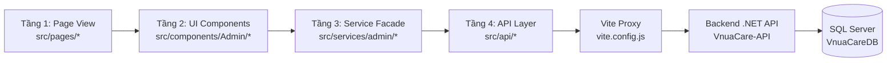

# 01. Kiến Trúc, Cấu Trúc Thư Mục & Chi Tiết Các Trang VnuaCare-UI

> **Tài liệu tổng hợp chuẩn nhất** *(gộp từ `PROJECT_STRUCTURE`, `KIEN_TRUC_VA_MO_HINH_DU_AN`, `HUONG_DAN_KIEN_TRUC_VA_LUONG_HOAT_DONG_ADMIN`, `LUONG_HOAT_DONG_TOAN_BO_HE_THONG`, `TONG_QUAN_CAC_TRANG_VA_CACH_HOAT_DONG_WEB` và `SRC_REVIEW`)* — cập nhật chính xác 100% theo mã nguồn hiện tại.

---

## 1. Bức Tranh Tổng Thể: Kiến Trúc 4 Tầng (4-Layer Architecture)

Ví von dễ hiểu theo mô hình **Nhà hàng**:
- **Frontend (`VnuaCare-UI` — React + Vite):** Là **phòng ăn & thực đơn** nơi khách hàng nhìn thấy và bấm đặt món.
- **Vite Proxy (`vite.config.js`):** Là **cửa thông phòng** tự chuyển tiếp mọi yêu cầu `/api/...` sang đúng cổng của nhà bếp (Backend).
- **Backend (`VnuaCare-API` — .NET 9):** Là **nhà bếp** kiểm tra thẻ (JWT Token), kiểm tra quyền và chế biến dữ liệu.
- **Database (`VnuaCareDB` — SQL Server):** Là **kho nguyên liệu** chứa 24 bảng dữ liệu (`vc_users`, `vc_staffs`, `vc_doctors`, `vc_health_checkup_records`...).

Bên trong Frontend, cả **6 trang Quản trị** đều được tách đồng nhất theo **4 tầng rõ ràng**:



---

## 2. Cây Thư Mục Thực Tế Hiện Tại Của `src/` (90 File — 0 File Thừa)

```text
src/
├── main.jsx                         # Điểm khởi chạy React gắn vào #root trong index.html
├── App.jsx                          # Bọc toàn app trong AuthProvider & NavigationProvider
├── index.css                        # CSS reset toàn cục
├── app/
│   └── AppRouter.jsx                # Bộ điều hướng & chặn phân quyền theo vai trò (RBAC)
├── core/
│   ├── contexts/                    # Bộ nhớ dùng chung toàn app (AuthContext, NavigationContext)
│   └── layouts/                     # Khung MainLayout cố định (Header, Sidebar thu gọn, Main cuộn, Footer)
├── pages/                           # Tầng 1: Các trang mỏng (~12-15 dòng) gắn MainLayout
│   ├── home/                        # Trang chủ giới thiệu
│   ├── auth/                        # Trang đăng nhập
│   ├── dashboard/                   # Bảng điều khiển tổng quan
│   ├── health-records/              # Quản lý hồ sơ khám sức khỏe
│   ├── staff-manager/               # Quản lý cán bộ / nhân viên
│   ├── doctor-manager/              # Quản lý bác sĩ
│   ├── user-manager/                # Quản lý tài khoản người dùng
│   ├── settings/                    # Cài đặt tài khoản cá nhân
│   └── staff-portal/                # Cổng riêng dành cho vai trò STAFF
├── components/
│   ├── Auth/                        # LoginForm.jsx
│   ├── SupportAgent/                # Thành phần dùng chung (Icons.jsx, Tabs.jsx)
│   └── Admin/                       # Tầng 2: Giao diện từng phân hệ quản trị
│       ├── DashboardManagement/     # DashboardManager, DashboardStatsCharts, DashboardRecentRecords
│       ├── HealthRecordManagement/  # SearchHealthRecordList, Filter, Table, FormModal, RecordDetailModal + tabs/
│       ├── StaffManagement/         # SearchStaffList, StaffFilter, StaffTable, StaffDetail
│       ├── DoctorManagement/        # SearchDoctorList, DoctorFilter, DoctorTable, DoctorDetail
│       ├── AccountManagement/       # SearchAccountList, AccountFilter, AccountTable, AccountDetail
│       └── Settingmanagerment/      # Settings.jsx, Settings.css (Hồ sơ cá nhân & Đổi mật khẩu)
├── services/admin/                  # Tầng 3: Service Facade (Account, Doctor, Staff, HealthRecord, DiagnosticReport)
├── api/                             # Tầng 4: Gọi fetch() thuần + httpClient.js đính kèm Bearer Token
├── models/                          # Lớp dữ liệu OOP (DiagnosticReport.js, SpecialistExam.js)
├── utils/                           # Hằng số dùng chung (index.js), từ điển URL (api-router.js), hàm tiện ích (utils.js)
├── styles/                          # admin.css (CSS nền dùng chung cho toàn bộ trang Admin)
└── assets/img_avatars/              # 6 ảnh đại diện SVG có sẵn
```

---

## 3. Chi Tiết Chức Năng Của Từng Trang Trong Web (9 Trang)

### 3.1. Trang Chủ (`HomePage.jsx`)
- Màn hình mặc định khi **chưa đăng nhập** (hoặc khi người đã đăng nhập bấm vào Logo trên Header).
- Giới thiệu cổng y tế VNUA và có nút dẫn sang màn hình Đăng nhập (`navigate('login')`).

### 3.2. Trang Đăng Nhập (`LoginPage.jsx` + `LoginForm.jsx`)
- Gửi `POST /api/v1/authorization/login` qua `authApi.js`.
- Nhận về `{ accessToken, username, fullname, email, role }`, gọi `login(data)` lưu vào `AuthContext` & `localStorage`, rồi chuyển vào trang phù hợp theo vai trò.

### 3.3. Bảng Điều Khiển Tổng Quan (`DashboardPage.jsx`)
- Page mỏng 14 dòng → gọi `DashboardManager.jsx` gồm 3 khối dữ liệu **100% từ API thật**:
  1. **4 Thẻ KPI (`STAT_CARDS` từ `utils/index.js`):** Tổng Cán bộ (`StaffService`), Tổng Bác sĩ (`DoctorService`), Tổng Hồ sơ khám (`HealthRecordService`), Số Đợt khám (`HealthRecordService.getCampaigns`). Bấm vào thẻ (nếu đủ quyền) nhảy thẳng tới trang quản lý đó.
  2. **2 Khung thanh tỷ lệ (`DashboardStatsCharts.jsx`):** Tỷ lệ Phân loại sức khỏe (`DEFAULT_HEALTH_CLASSIFICATIONS`) và Tiến độ hồ sơ (`RECORD_STATUS`, `RECORD_STATUS_LABELS`).
  3. **Bảng 5 hồ sơ gần đây (`DashboardRecentRecords.jsx`):** Hiện 5 hồ sơ mới nhất + nút *"Xem tất cả hồ sơ →"*.

### 3.4. Quản Lý Hồ Sơ Khám (`HealthRecordsPage.jsx`)
Tách rạch ròi 2 luồng nghiệp vụ:
- **Luồng hành chính hồ sơ:** `SearchHealthRecordList.jsx` điều phối `HealthRecordFilter.jsx` (tìm kiếm + 4 bộ lọc), `HealthRecordTable.jsx` (bảng + phân trang), `HealthRecordFormModal.jsx` (modal Tạo/Sửa thông tin tiếp nhận) thông qua `HealthRecordService.js` → `recordApi.js`.
- **Luồng khám chuyên môn 5 Tab:** Bấm nút Con mắt (👁️) mở `RecordDetailModal.jsx` chứa 5 tab phẳng trong `tabs/`:
  1. `VitalSignsTab.jsx` — Thể lực & Sinh tồn (`vc_vital_signs`).
  2. `InternalMedicineTab.jsx` — Khám Nội khoa 6 hệ cơ quan (`vc_internal_medicine_exams`).
  3. `SpecialistExamsTab.jsx` — Chuyên khoa lẻ: Mắt, TMH, RHM, Da liễu, Ngoại, Sản (`vc_specialist_exams`).
  4. `DiagnosticReportsTab.jsx` — Chẩn đoán hình ảnh: Siêu âm, X-quang, Điện tim (`vc_diagnostic_reports`, lưu JSON `findings_data`).
  5. `GeneralConclusionTab.jsx` — Kết luận & Xếp loại tổng thể (`vc_health_checkup_records`).

### 3.5. Quản Lý Nhân Viên / Cán Bộ (`StaffManagerPage.jsx`)
- `SearchStaffList` → `StaffFilter`, `StaffTable`, `StaffDetail` → `StaffService` → `staffApi.js`.
- Tìm kiếm, lọc theo Khoa/Phòng, phân trang, thêm/sửa/xóa cán bộ và gán tài khoản `STAFF`.

### 3.6. Quản Lý Bác Sĩ (`DoctorManagerPage.jsx`)
- `SearchDoctorList` → `DoctorFilter`, `DoctorTable`, `DoctorDetail` → `DoctorService` → `doctorApi.js`.
- Tìm kiếm, lọc theo Chuyên khoa, phân trang, thêm/sửa/xóa bác sĩ và gán tài khoản `DOCTOR`.

### 3.7. Quản Lý Tài Khoản Người Dùng (`UserManagerPage.jsx` — Chỉ `SUPER_ADMIN`)
- `SearchAccountList` → `AccountFilter`, `AccountTable`, `AccountDetail` → `AccountService` → `userApi.js`.
- Quản lý danh sách tài khoản, lọc theo vai trò, tạo tài khoản, phân quyền, khóa/mở khóa (`isActive`), xóa tài khoản.

### 3.8. Cài Đặt Tài Khoản (`SettingsAdmin.jsx` → `Settings.jsx`)
- Kết nối `AccountService` (`getMyProfile`, `updateMyProfile`, `changePassword`) → `userApi.js`.
- **Tab 1 — Hồ sơ cá nhân:** Hiển thị động đúng các cột có trong SQL của từng vai trò:
  - `SUPER_ADMIN` / `HEALTH_ADMIN`: Chỉ sửa `Email liên hệ`.
  - `DOCTOR`: Sửa `Họ và tên` + `Email`.
  - `STAFF`: Sửa đầy đủ `Họ tên`, `Email`, `SĐT`, `Giới tính`, `Ngày sinh`, `Địa chỉ`, `Avatar`.
- **Tab 2 — Đổi mật khẩu:** Kiểm tra độ dài ≥ 6 ký tự, khớp mật khẩu xác nhận, không trùng mật khẩu cũ.

### 3.9. Cổng Cán Bộ (`StaffPortalPage.jsx` — Dành riêng cho `STAFF`)
- Tách khỏi khung Admin, hiển thị lời chào theo vai trò tiếng Việt (`ROLE_LABELS`), nút Về trang chủ và Đăng xuất (khung sẵn để phát triển xem hồ sơ khám cá nhân).

---

## 4. Vite Proxy (`vite.config.js`) — Cơ Chế Gọi API Local Không Lỗi CORS

Khi Frontend chạy ở `http://localhost:5173` và gọi `fetch('/api/v1/...')`:
- Trình duyệt gửi request tới cùng cổng `5173` (nên **không bị chặn CORS**).
- Vite đọc `vite.config.js` thấy đường dẫn bắt đầu bằng `/api` liền chuyển tiếp sang Backend (`http://localhost:5049` của Kestrel trên Mac/Win hoặc `https://localhost:44310` của IIS Express trên Win).
- **Lưu ý lỗi 502 Bad Gateway:** Lỗi 502 không phải lỗi CORS mà xảy ra khi cổng `target` trong `vite.config.js` không khớp cổng Backend đang chạy thực tế.

---

## 5. Mẫu Trả Lời Vấn Đáp Nhanh Khi Bảo Vệ Đồ Án

> **Câu hỏi:** *"Dữ liệu ở một bảng / ô dropdown bất kỳ (VD: `departments`) lấy từ đâu ra?"*
>
> **Trả lời chuẩn 5 bước (giữ `Cmd` + Click để mở lần lượt):**
> 1. **Component hiển thị (`HealthRecordFilter.jsx`):** Nhận `departments` qua **`props`** từ component cha.
> 2. **Component cha (`SearchHealthRecordList.jsx`):** Khai báo `useState` và gọi Service bên trong `useEffect`.
> 3. **Service (`HealthRecordService.js`):** Lớp trung gian gọi hàm API tương ứng.
> 4. **API (`recordApi.js` + `api-router.js`):** Dùng `fetch()` kèm JWT Token từ `httpClient.js` gọi đúng endpoint.
> 5. **Backend & SQL Server:** Request qua Vite Proxy tới Controller `.NET`, truy vấn bảng trong `VnuaCareDB` và trả JSON về cập nhật state để React vẽ lại giao diện.
