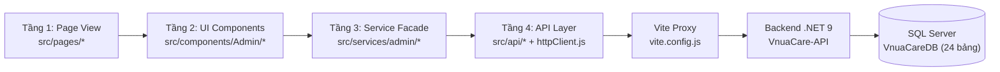

# 01. Tổng Quan Kiến Trúc, Các Mô Hình Áp Dụng, Cây Thư Mục & Chi Tiết 9 Trang

> Tài liệu tổng kết kiến trúc tổng thể, các mẫu thiết kế phần mềm (Architecture & Design Patterns), cấu trúc thư mục thực tế và chức năng chi tiết từng màn hình của `VnuaCare-UI`.

---

## 1. Kiến Trúc Tổng Thể Hệ Thống

Hệ thống VnuaCare hoạt động theo kiến trúc **Client–Server tách biệt hoàn toàn** qua chuẩn **RESTful API**:

- **Frontend (`VnuaCare-UI` — React 19 + Vite 8):** Ứng dụng một trang (**SPA — Single Page Application**), chịu trách nhiệm hiển thị giao diện, kiểm tra dữ liệu nhập ban đầu và quản lý trải nghiệm người dùng.
- **Vite Proxy (`vite.config.js`):** Cổng chuyển tiếp nội bộ giúp mọi yêu cầu `/api/...` từ cổng `5173` tự động định tuyến sang cổng của Backend mà không gặp lỗi chặn CORS trên trình duyệt.
- **Backend (`VnuaCare-API` — .NET 9 + MediatR CQRS):** Xác thực chữ ký JWT Bearer Token, kiểm tra phân quyền theo vai trò, xử lý nghiệp vụ y tế, quản lý bộ nhớ đệm (Cache) và giao tiếp cơ sở dữ liệu.
- **Database (`VnuaCareDB` — SQL Server):** Gồm **24 bảng** lưu trữ người dùng, cán bộ, bác sĩ, đợt khám, hồ sơ khám, sinh hiệu, nội khoa, chuyên khoa lẻ, chẩn đoán hình ảnh (kết hợp cột JSON động `findings_data`), xét nghiệm và đơn thuốc.



---

## 2. Phân Tích 7 Mô Hình Kiến Trúc & Mẫu Thiết Kế Áp Dụng Trong Bài

### 2.1. Kiến trúc phân tầng 4 lớp (4-Layer Architecture)
Toàn bộ các phân hệ quản trị ở Frontend đều tuân thủ chặt chẽ 4 tầng tách biệt trách nhiệm:

| Tầng | Thư mục | Trách nhiệm duy nhất | File tiêu biểu |
| :--- | :--- | :--- | :--- |
| **Tầng 1 — Page View** | `src/pages/*` | Vỏ trang mỏng (~14–16 dòng), gắn khung `MainLayout` với Container của phân hệ. | `DashboardPage.jsx`, `HealthRecordsPage.jsx`, `StaffManagerPage.jsx` |
| **Tầng 2 — UI Components** | `src/components/Admin/*` | Quản lý trạng thái giao diện, bộ lọc, bảng phân trang, modal biểu mẫu và các tab khám. | `DashboardManager.jsx`, `SearchHealthRecordList.jsx`, `AccountDetail.jsx` |
| **Tầng 3 — Service Facade** | `src/services/admin/*` | Lớp trung gian gom nhóm các hàm API theo đúng đối tượng nghiệp vụ, kiểm tra và sắp xếp dữ liệu. | `HealthRecordService.js`, `DiagnosticReportService.js`, `AccountService.js` |
| **Tầng 4 — API / HTTP** | `src/api/*` | Gọi `fetch()`, gắn JWT từ `httpClient.js`, kiểm tra lỗi HTTP và bóc tách JSON trả về. | `httpClient.js`, `recordApi.js`, `userApi.js`, `staffApi.js` |

- **Lý do áp dụng:** Sửa giao diện (CSS, bố cục bảng) chỉ chạm Tầng 2 mà không ảnh hưởng API; ngược lại khi Backend đổi đường dẫn hoặc đổi cấu trúc JSON trả về chỉ cần sửa ở `api-router.js` và Tầng 4, toàn bộ giao diện phía trên vẫn giữ nguyên.

### 2.2. Mẫu Container / Presentational Pattern & So Sánh Với MVVM
Mỗi phân hệ quản trị đều chia thành **Component Cha (Container)** và các **Component Con (Presentational)**:
- **Container (Cha — điều phối dữ liệu):** Giữ `useState`, chạy `useEffect` gọi Service, xử lý sự kiện Thêm/Sửa/Xóa.
  - Ví dụ: `DashboardManager.jsx`, `SearchHealthRecordList.jsx`, `SearchStaffList.jsx`, `SearchDoctorList.jsx`, `SearchAccountList.jsx`.
- **Presentational (Con — thuần hiển thị):** Không tự gọi API, chỉ nhận dữ liệu qua `props` để hiển thị HTML và báo sự kiện người dùng ngược lên Cha qua hàm callback (`onEdit`, `onDelete`, `onPageChange`, `onViewAll`).
  - Ví dụ: bộ 3 đồng nhất `*Filter.jsx` + `*Table.jsx` + `*Detail.jsx` / `*FormModal.jsx`, hoặc `DashboardStatsCharts.jsx` + `DashboardRecentRecords.jsx`.

> **Lưu ý quan trọng khi bảo vệ — Bài có dùng mô hình MVVM không?**
> - **Không phải MVVM thuần túy**, vì MVVM chuẩn (WPF, Angular, Vue) dựa trên **Two-Way Data Binding** tự động và tách riêng lớp `ViewModel` độc lập khỏi giao diện; trong khi React hoạt động theo **One-Way Data Flow (luồng dữ liệu 1 chiều: Props Down, Events Up)**.
> - Tuy nhiên, cách tổ chức của bài **mang tư duy phân tách tương đồng với MVVM**:
>   - **Model:** `src/models/` + `src/services/` + `src/api/`
>   - **Vai trò tương đương ViewModel:** Các `Container Component` + `Context / Custom Hooks`
>   - **View:** Các `Presentational Component` thuần hiển thị.

### 2.3. Mẫu Context API + Provider + Custom Hook (Quản lý trạng thái toàn cục)
Thay vì truyền `user` hay `activeTab` qua 5–6 tầng `props` liên tiếp (*prop-drilling*), dự án bọc 2 Provider ở gốc `src/App.jsx`:
- `AuthProvider.jsx` + `useAuth.js`: Quản lý thông tin người dùng đang đăng nhập và đồng bộ `localStorage`.
- `NavigationProvider.jsx` + `useNavigation.js`: Quản lý chuyển trang SPA đồng bộ với **Browser History API** (`window.location.pathname`, `window.history.pushState`, sự kiện `popstate` — đường dẫn sạch `/dashboard`, `/records`, `/staffs`, `/doctors`, `/users`, `/settings`...).

### 2.4. Mẫu Layout Composition (`children` Slot Pattern)
`MainLayout.jsx` định nghĩa cố định `Header` + `Sidebar` + `Footer` đúng một lần duy nhất; nội dung riêng của từng màn hình được truyền vào khe `{children}`, giúp mọi trang quản trị đồng nhất 100% bố cục mà không lặp code.

### 2.5. Mô hình Phân quyền theo vai trò — RBAC 3 lớp (Role-Based Access Control)
Dùng mảng `MENU_ITEMS` trong `src/utils/index.js` làm **nguồn cấu hình duy nhất (Single Source of Truth)** kết hợp kiểm tra ở 3 lớp: ẩn menu trên `Sidebar.jsx`, chặn điều hướng trên `AppRouter.jsx` và xác thực JWT Role tại Backend `.NET`.

### 2.6. Mẫu Tái Sử Dụng Modal Đa Chế Độ (`ModelMode`) & Configuration-Driven UI
- Dùng chung **1 component biểu mẫu duy nhất** cho cả Thêm mới và Cập nhật (`AccountDetail.jsx`, `StaffDetail.jsx`, `DoctorDetail.jsx`, `HealthRecordFormModal.jsx`), rẽ nhánh qua hằng số `ModelMode.CREATE` và `ModelMode.EDIT` — giảm 50% code giao diện trùng lặp.
- Các danh mục thẻ KPI (`STAT_CARDS`), menu (`MENU_ITEMS`), nhãn vai trò (`ROLE_LABELS`), trạng thái hồ sơ (`RECORD_STATUS_LABELS`), phân loại sức khỏe (`DEFAULT_HEALTH_CLASSIFICATIONS`) được cấu hình tập trung tại `src/utils/index.js`.

### 2.7. Mẫu Domain Model OOP Kết Hợp JSON Động (`DiagnosticReport`)
Giải quyết bài toán thực tế của y tế: mỗi kỹ thuật chẩn đoán hình ảnh (Siêu âm ổ bụng, Siêu âm tuyến giáp, X-quang, Điện tim...) có các vùng giải phẫu hoàn toàn khác nhau. Lớp đối tượng `DiagnosticReport` và `FindingSection` (`src/models/DiagnosticReport.js`) chuyển đổi linh hoạt giữa giao diện gạch đầu dòng động trên React và chuỗi JSON lưu trong cột `findings_data` của SQL Server.

---

## 3. Cây Thư Mục Thực Tế Hiện Tại

```text
VnuaCare-UI/
├── index.html                           # Trang HTML gốc duy nhất của SPA (gắn favicon.png)
├── vite.config.js                       # Cấu hình Vite & Proxy chuyển tiếp /api sang Backend
├── eslint.config.js                     # Cấu hình kiểm tra chuẩn code ESLint
├── public/                              # Tài nguyên tĩnh truy cập trực tiếp từ gốc "/"
│   ├── favicon.png                      # Icon vuông dấu "+" cắt sát viền (128x128) trên tab trình duyệt
│   ├── logo.png                         # Logo ngang đầy đủ VnuaCare (dùng ở Header, Home, Login)
│   ├── logo-icon.png                    # Biểu tượng dấu "+" vuông độc lập
│   ├── logo-vnua.png                    # Huy hiệu Học viện Nông nghiệp Việt Nam
│   └── avatars/                         # Ảnh đại diện tĩnh
├── docs/                                # Bộ 5 tài liệu Markdown tổng kết dự án & backend-portal/
└── src/
    ├── main.jsx                         # Điểm khởi chạy React gắn vào #root
    ├── App.jsx                          # Component gốc bọc AuthProvider & NavigationProvider
    ├── index.css                        # CSS reset toàn cục
    ├── app/
    │   └── AppRouter.jsx                # Bộ điều hướng trung tâm & chặn quyền truy cập (RBAC Guard)
    ├── core/
    │   ├── contexts/                    # AuthContext, NavigationContext & 2 Custom Hooks (useAuth, useNavigation)
    │   └── layouts/                     # MainLayout.jsx, MainLayout.css + Header.jsx, Sidebar.jsx, Footer.jsx
    ├── pages/                           # Tầng 1: 9 trang Page View mỏng
    │   ├── home/                        # HomePage.jsx, HomePage.css (Trang chủ giới thiệu)
    │   ├── auth/                        # LoginPage.jsx, LoginPage.css (Trang đăng nhập)
    │   ├── dashboard/                   # DashboardPage.jsx, DashboardPage.css
    │   ├── health-records/              # HealthRecordsPage.jsx, HealthRecordsPage.css
    │   ├── staff-manager/               # StaffManagerPage.jsx, StaffManagerPage.css
    │   ├── doctor-manager/              # DoctorManagerPage.jsx, DoctorManagerPage.css
    │   ├── user-manager/                # UserManagerPage.jsx, UserManagerPage.css
    │   ├── settings/                    # SettingsAdmin.jsx
    │   └── staff-portal/                # StaffPortalPage.jsx (Cổng riêng dành cho vai trò STAFF)
    ├── components/
    │   ├── Auth/                        # LoginForm.jsx
    │   ├── SupportAgent/                # Icons.jsx (21 SVG icons), Tabs.jsx
    │   └── Admin/                       # Tầng 2: Giao diện nghiệp vụ quản trị
    │       ├── DashboardManagement/     # DashboardManager, DashboardStatsCharts, DashboardRecentRecords
    │       ├── HealthRecordManagement/  # SearchHealthRecordList, HealthRecordFilter, HealthRecordTable,
    │       │   │                        # HealthRecordFormModal, RecordDetailModal (+ .css)
    │       │   └── tabs/                # 4 Tab khám chuyên môn phẳng + RecordTabs.css:
    │       │                            # VitalSignsTab, InternalMedicineTab, SpecialistExamsTab, DiagnosticReportsTab
    │       ├── StaffManagement/         # SearchStaffList, StaffFilter, StaffTable, StaffDetail
    │       ├── DoctorManagement/        # SearchDoctorList, DoctorFilter, DoctorTable, DoctorDetail
    │       ├── AccountManagement/       # SearchAccountList, AccountFilter, AccountTable, AccountDetail
    │       └── SettingManagement/       # Settings.jsx, Settings.css (Hồ sơ cá nhân & Đổi mật khẩu)
    ├── services/admin/                  # Tầng 3: AccountService, DoctorService, StaffService,
    │                                    #         HealthRecordService, DiagnosticReportService
    ├── api/                             # Tầng 4: httpClient.js + 9 file *Api.js (auth, user, staff, doctor,
    │                                    #         record, vitalSigns, internalMedicine, specialistExam, diagnosticReport)
    ├── models/                          # DiagnosticReport.js, SpecialistExam.js
    ├── utils/                           # index.js (hằng số chung), api-router.js (URL endpoints), utils.js (formatDate)
    ├── styles/                          # admin.css (CSS hệ thống dùng chung cho các trang Admin)
    └── assets/img_avatars/              # 6 ảnh đại diện SVG dựng sẵn
```

---

## 4. Chi Tiết Chức Năng Từng Trang (9 Trang)

1. **Trang Chủ (`HomePage.jsx`):** Giới thiệu Cổng Tra cứu & Quản lý Sức khỏe Điện tử VNUA, hiển thị logo `/logo.png` và nút dẫn vào Đăng nhập hoặc Bảng điều khiển (nếu đã đăng nhập).
2. **Trang Đăng Nhập (`LoginPage.jsx` + `LoginForm.jsx`):** Xác thực tài khoản qua `POST /api/v1/authorization/login`, lưu JWT `accessToken` và điều hướng tự động theo vai trò.
3. **Bảng Điều Khiển (`DashboardPage.jsx` → `DashboardManager.jsx`):**
   - **4 thẻ KPI thời gian thực** (`STAT_CARDS`): Tổng Cán bộ, Tổng Bác sĩ, Tổng Hồ sơ khám, Số Đợt khám (bấm vào thẻ sẽ chuyển nhanh sang trang tương ứng nếu vai trò có quyền).
   - **2 biểu đồ thanh ngang** (`DashboardStatsCharts.jsx`): Tỷ lệ Phân loại sức khỏe Bộ Y tế (`Loại I → Loại V`, `Chưa xếp loại`) và Tiến độ xử lý hồ sơ (`Hoàn thành`, `Đang khám`, `Chờ khám`, `Đã hủy`).
   - **Bảng 5 hồ sơ gần đây** (`DashboardRecentRecords.jsx`): Tóm tắt nhanh các hồ sơ mới nhất kèm nút *"Xem tất cả hồ sơ →"*.
4. **Quản Lý Hồ Sơ Khám (`HealthRecordsPage.jsx` → `SearchHealthRecordList.jsx`):**
   - **Ngoài bảng hồ sơ:** Tìm kiếm đa tiêu chí (SID, tên/mã cán bộ, đợt khám, khoa/phòng, xếp loại, trạng thái), thêm mới hồ sơ tiếp nhận và **cập nhật trực tiếp tiền sử bệnh, kết luận tổng quát, lời dặn, bác sĩ kết luận, xếp loại sức khỏe chung** tại `HealthRecordFormModal.jsx`.
   - **Trong cửa sổ khám chuyên khoa (`RecordDetailModal.jsx`):** Bấm biểu tượng Con mắt mở **4 Tab khám chuyên môn** (Thể lực & Sinh tồn, Nội khoa, Chuyên khoa lẻ, Chẩn đoán hình ảnh). Khi đóng cửa sổ, bảng bên ngoài tự làm mới để cập nhật trạng thái hồ sơ mới nhất.
5. **Quản Lý Cán Bộ (`StaffManagerPage.jsx` → `SearchStaffList.jsx`):** Tìm kiếm, lọc theo Khoa/Phòng ban, phân trang, thêm/sửa/xóa hồ sơ cán bộ, chọn avatar mẫu và liên kết tài khoản `STAFF`.
6. **Quản Lý Bác Sĩ (`DoctorManagerPage.jsx` → `SearchDoctorList.jsx`):** Tìm kiếm, lọc theo Chuyên khoa, phân trang, thêm/sửa/xóa bác sĩ, quản lý số chứng chỉ hành nghề (CCHN) và liên kết tài khoản `DOCTOR`.
7. **Quản Lý Người Dùng (`UserManagerPage.jsx` → `SearchAccountList.jsx` — riêng `SUPER_ADMIN`):** Quản lý toàn bộ tài khoản đăng nhập, lọc theo vai trò, cấp tài khoản mới, đổi quyền, khóa/mở khóa (`isActive`) và xóa tài khoản.
8. **Cài Đặt Tài Khoản (`SettingsAdmin.jsx` → `Settings.jsx`):**
   - **Tab 1 — Hồ sơ cá nhân:** Tải dữ liệu thật từ `GET /api/v1/users/me`, hiển thị khối định danh chỉ đọc (Tên đăng nhập, Vai trò, Mã bác sĩ/chuyên khoa hoặc Mã cán bộ/phòng ban) và cho phép cập nhật **Họ và tên** + **Email liên hệ** (`PUT /api/v1/users/profile`), đồng thời đồng bộ ngay tên hiển thị mới lên `Header` qua `AuthContext`.
   - **Tab 2 — Đổi mật khẩu:** Kiểm tra 4 điều kiện ở Frontend (đủ 3 ô, tối thiểu 6 ký tự, khớp mật khẩu xác nhận, khác mật khẩu cũ) trước khi gọi `POST /api/v1/users/change-password`.
9. **Cổng Cán Bộ (`StaffPortalPage.jsx` — riêng `STAFF`):** Giao diện riêng biệt tách khỏi khung quản trị Admin dành cho cán bộ/giảng viên đăng nhập tra cứu thông tin sức khỏe cá nhân.

---

## 5. Cơ Chế Vite Proxy (`vite.config.js`) & Lưu Ý Lỗi 502

- Khi chạy local ở `http://localhost:5173`, mọi lệnh `fetch('/api/v1/...')` gửi về chính cổng `5173` nên trình duyệt xem là cùng nguồn (Same-Origin) → **không bị lỗi CORS**.
- Vite tự chuyển tiếp ngầm sang cổng Backend cấu hình tại `server.proxy['/api'].target` trong `vite.config.js` (`http://localhost:5049` khi chạy Kestrel trên macOS/Windows CLI hoặc `https://localhost:44310` khi chạy IIS Express trên Visual Studio Windows).
- Nếu trình duyệt báo **`502 Bad Gateway`**, nghĩa là Backend chưa bật hoặc cổng `target` trong `vite.config.js` đang khác với cổng Backend đang chạy.
