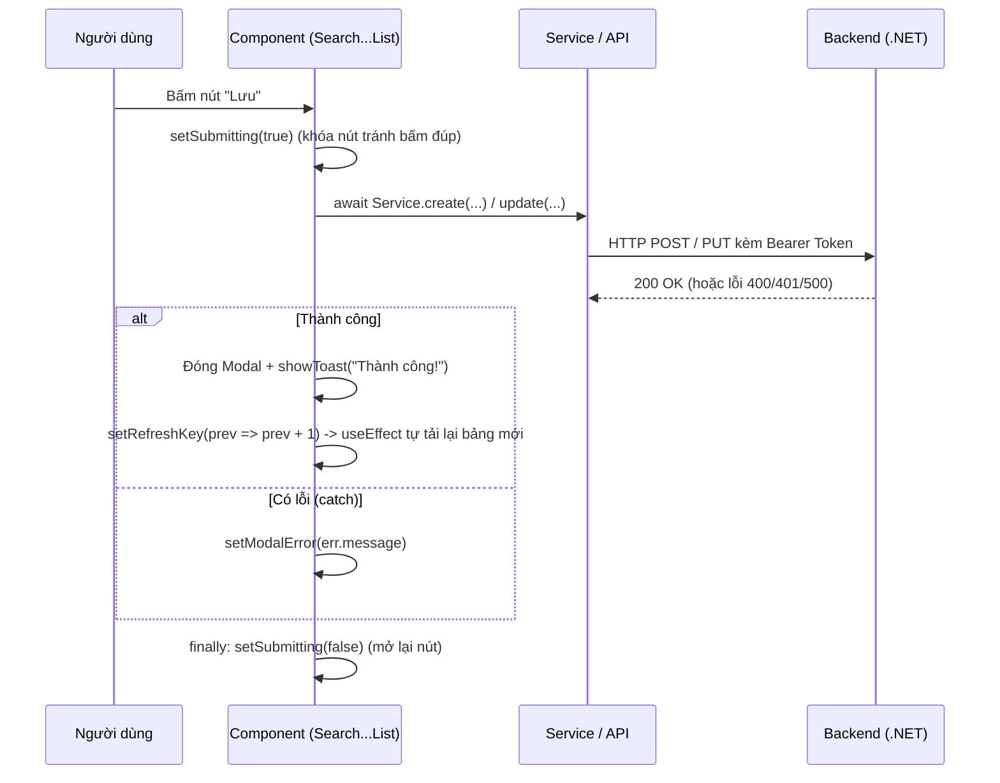

# 02. Luồng Xác Thực (Auth), Phân Quyền (RBAC) & Cơ Chế Sự Kiện React

> **Tài liệu tổng hợp chuẩn nhất** *(gộp từ `GIAI_THICH_AUTH_PROVIDER`, `FLOW_AUTH_VA_CAP_NHAT_THONG_TIN` và `CO_CHE_SU_KIEN_VA_DIEU_HUONG_CHI_TIET`)* — cập nhật đúng theo đường dẫn và code hiện tại.

---

## 1. Mổ Xẻ Chi Tiết `AuthProvider.jsx` (`src/core/contexts/AuthProvider.jsx`)

`AuthProvider` là "bộ nhớ trung tâm" bọc ngoài toàn bộ ứng dụng tại `src/App.jsx` để mọi màn hình đều biết **ai đang đăng nhập**.

```jsx
export function AuthProvider({ children }) {
  // 1. Khi vừa mở web hoặc bấm F5: đọc lại 'user' từ localStorage
  const [user, setUser] = useState(() => {
    const savedUser = localStorage.getItem('user');
    return savedUser ? JSON.parse(savedUser) : null;
  });

  // 2. Khi đăng nhập thành công (hoặc cập nhật tên/email ở Cài đặt)
  const login = (userData) => {
    setUser(userData);
    localStorage.setItem('user', JSON.stringify(userData));
    if (userData.accessToken) {
      localStorage.setItem('accessToken', userData.accessToken);
    }
  };

  // 3. Khi bấm Đăng xuất: xóa sạch bộ nhớ & đẩy về màn hình khách
  const logout = () => {
    setUser(null);
    localStorage.removeItem('user');
    localStorage.removeItem('accessToken');
  };

  return (
    <AuthContext.Provider value={{ user, login, logout }}>
      {children}
    </AuthContext.Provider>
  );
}
```

### Luồng đi của JWT Bearer Token:
1. User đăng nhập tại `LoginForm.jsx` → `authApi.js` gọi `POST /api/v1/authorization/login`.
2. Backend trả về `accessToken` → `AuthProvider.login()` cất vào `localStorage.setItem('accessToken', ...)`.
3. Mọi API quản trị về sau đều gọi `getAuthHeaders()` trong `src/api/httpClient.js`:
   ```js
   Authorization: `Bearer ${localStorage.getItem('accessToken')}`
   ```
4. Backend kiểm tra chữ ký JWT hợp lệ và đúng `Role` thì mới trả dữ liệu.

---

## 2. Cơ Chế Phân Quyền Theo Vai Trò (RBAC)

Toàn bộ quyền được khai báo tại **1 nguồn duy nhất** là `MENU_ITEMS` trong `src/utils/index.js`:

| Vai trò (`ROLES`) | Tên tiếng Việt (`ROLE_LABELS`) | Màn hình sau khi đăng nhập |
| :--- | :--- | :--- |
| `SUPER_ADMIN` | Quản trị hệ thống | Khung Admin — thấy **tất cả 6 mục** (`dashboard`, `records`, `staffs`, `doctors`, `users`, `settings`). |
| `HEALTH_ADMIN` | Quản trị y tế | Khung Admin — thấy **5 mục** (ẩn `Quản lý người dùng`). |
| `DOCTOR` | Bác sĩ | Khung Admin — thấy **3 mục** (`Bảng điều khiển`, `Hồ sơ khám cán bộ`, `Cài đặt`). |
| `STAFF` | Cán bộ / Giảng viên | Tách sang cổng riêng `StaffPortalPage.jsx` (không vào khung Admin). |

### Bảo vệ 2 lớp:
- **Lớp 1 (Ẩn giao diện):** `Sidebar.jsx` lọc `MENU_ITEMS.filter(item => item.roles.includes(userRole))` nên người dùng không thấy nút menu bị cấm.
- **Lớp 2 (Chặn điều hướng):** `AppRouter.jsx` kiểm tra `canAccessTab(activeTab, userRole)` — nếu cố mở tab không đủ quyền, tự động đẩy về `DashboardPage`.

---

## 3. Khung Giao Diện `MainLayout` & Sidebar Thu Gọn Cố Định

- `MainLayout.jsx` lưu trạng thái `sidebarCollapsed` vào `localStorage` để khi chuyển trang, thanh menu giữ nguyên trạng thái đóng/mở.
- `MainLayout.css` khóa `.app-layout` bằng `height: 100vh; overflow: hidden`:
  - **Header (`64px`)** dính trên cùng.
  - **Sidebar (`248px` mở rộng / `72px` thu gọn)** đứng yên hoàn toàn bên trái (`overflow: hidden`, không cuộn).
  - **Main Content (`.app-main`)** là vùng duy nhất có thanh cuộn dọc (`overflow-y: auto`).

---

## 4. 6 Cơ Chế Sự Kiện Cốt Lõi Của React SPA Trong Dự Án

### Cơ chế 1 — Đổi trang không reload (`NavigationProvider`)
Bấm nút trên `Sidebar` → gọi `navigate('doctors')` → `setActiveTab('doctors')` → `AppRouter` tự động re-render sang `<DoctorManagerPage />`.

### Cơ chế 2 — Giao tiếp Cha – Con (`Props Down, Events Up`)
- **Cha truyền dữ liệu xuống Con qua `props`:** `<HealthRecordFilter departments={departments} search={search} />`.
- **Con báo sự kiện ngược lên Cha qua hàm callback:** Khi gõ ô tìm kiếm, Con gọi `onSearchChange(e.target.value)` → Cha chạy `setSearch(val)` và `setPageNumber(1)`.

### Cơ chế 3 — Nhập liệu Form 2 chiều (Two-Way Binding)
```jsx
<input
  value={formData.email}                                 // State quyết định chữ hiển thị
  onChange={(e) => onFormChange('email', e.target.value)} // Gõ phím cập nhật lại State
/>
```

### Cơ chế 4 — Bật / Tắt Modal (Popup)
Dùng 1 state điều khiển:
- `modalMode === null` → Modal không vẽ ra màn hình (`if (!modalMode) return null`).
- `modalMode === ModelMode.CREATE` → Hiện Modal Tạo mới.
- `modalMode === ModelMode.EDIT` → Hiện Modal Cập nhật kèm dữ liệu sẵn.

### Cơ chế 5 — Chuyển đổi 5 Tab khám (`RecordDetailModal`)
- Giữ state `activeTab` (mặc định `'VITAL_SIGNS'`).
- Bấm nút tab → `setActiveTab(tab.key)` → hàm `renderTabContent()` hiển thị đúng component tab tương ứng và tự tải dữ liệu theo `recordId`.

### Cơ chế 6 — Chu trình bấm "Lưu" & Tải lại bảng (`refreshKey` + `isCancelled`)

- **Vì sao có `let isCancelled = false` trong `useEffect`?** Nếu bạn bấm chuyển sang trang khác lúc API chưa kịp trả về, hàm dọn dẹp `return () => { isCancelled = true; }` sẽ chặn việc gọi `setState` lên component đã bị đóng (tránh lỗi rò rỉ bộ nhớ).
