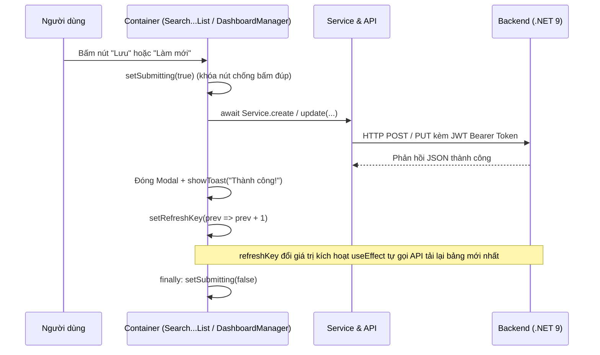

# 02. Luồng Xác Thực JWT, Phân Quyền RBAC & Cơ Chế Sự Kiện React

> Tài liệu giải thích chi tiết cơ chế đăng nhập, lưu phiên làm việc bằng JWT Bearer Token, phân quyền 3 lớp theo vai trò, bố cục cố định `MainLayout` và 6 cơ chế sự kiện React cốt lõi trong `VnuaCare-UI`.

---

## 1. Luồng Xác Thực & Quản Lý Phiên (`AuthProvider.jsx`)

`src/core/contexts/AuthProvider.jsx` bọc ngoài toàn bộ ứng dụng tại `src/App.jsx` để cung cấp thông tin tài khoản đang đăng nhập cho mọi màn hình:

```jsx
export function AuthProvider({ children }) {
  // Khôi phục thông tin user từ localStorage ngay khi mở web hoặc bấm F5
  const [user, setUser] = useState(() => {
    const savedUser = localStorage.getItem('user');
    return savedUser ? JSON.parse(savedUser) : null;
  });

  // Lưu thông tin user và JWT accessToken khi đăng nhập thành công (hoặc cập nhật hồ sơ cá nhân)
  const login = (userData) => {
    setUser(userData);
    localStorage.setItem('user', JSON.stringify(userData));
    if (userData.accessToken) {
      localStorage.setItem('accessToken', userData.accessToken);
    }
  };

  // Xóa sạch phiên đăng nhập khi bấm Đăng xuất
  const logout = () => {
    setUser(null);
    localStorage.removeItem('user');
    localStorage.removeItem('accessToken');
  };

  return (
    <AuthContext.Provider value={{ user, login, logout }}>
      {children}
    </AuthContext.Provider>
  );
}
```

### Đường đi đầy đủ của thẻ xác thực JWT:
1. Người dùng nhập tên đăng nhập & mật khẩu tại `LoginForm.jsx` → gọi `loginRequest()` trong `src/api/authApi.js` (`POST /api/v1/authorization/login`).
2. Backend kiểm tra mật khẩu mã hóa BCrypt, sinh chuỗi `accessToken` chứa `UserId`, `Username`, `Role` và trả về Frontend.
3. `LoginForm.jsx` gọi `login(userData)` → lưu `accessToken` và `user` vào `localStorage`.
4. Ở mọi thao tác quản trị tiếp theo, hàm `getAuthHeaders()` trong `src/api/httpClient.js` tự động đọc `localStorage.getItem('accessToken')` và gắn vào Header:
   ```js
   Authorization: `Bearer ${token}`
   ```
5. Backend kiểm tra chữ ký và thời hạn token: nếu hết hạn trả mã `401` để Frontend thông báo yêu cầu đăng nhập lại.

---

## 2. Cơ Chế Phân Quyền Theo Vai Trò — RBAC 3 Lớp

Toàn bộ danh sách quyền trên giao diện được khai báo tại **một nơi duy nhất** là hằng số `MENU_ITEMS` trong `src/utils/index.js`:

| Mã vai trò (`ROLES`) | Nhãn hiển thị (`ROLE_LABELS`) | Phạm vi truy cập |
| :--- | :--- | :--- |
| `SUPER_ADMIN` | Quản trị hệ thống | Vào khung Admin — toàn quyền **6/6 mục** (`dashboard`, `records`, `staffs`, `doctors`, `users`, `settings`). |
| `HEALTH_ADMIN` | Quản trị y tế | Vào khung Admin — thấy **5/6 mục** (ẩn `Quản lý người dùng`). |
| `DOCTOR` | Bác sĩ | Vào khung Admin — thấy **3/6 mục** (`Bảng điều khiển`, `Hồ sơ khám cán bộ`, `Cài đặt`). |
| `STAFF` | Cán bộ / Giảng viên | Chuyển sang cổng riêng `StaffPortalPage.jsx`, tách hoàn toàn khỏi khung quản trị Admin. |

### Ba lớp bảo vệ phối hợp chặt chẽ:
- **Lớp 1 — Ẩn trên giao diện (`Sidebar.jsx` & `DashboardManager.jsx`):**
  - `Sidebar.jsx` lọc `MENU_ITEMS.filter((item) => item.roles.includes(userRole))` để ẩn các menu không thuộc quyền.
  - Trên Dashboard, các thẻ KPI kiểm tra `canNavigateTo(card.targetTab)` — ví dụ tài khoản `DOCTOR` thấy con số tổng Cán bộ / Bác sĩ nhưng không bấm nhảy sang trang quản lý đó được.
- **Lớp 2 — Chặn tại bộ định tuyến (`src/app/AppRouter.jsx`):**
  - Hàm `canAccessTab(activeTab, userRole)` kiểm tra lại trước khi render trang. Kể cả khi người dùng tự gõ URL `/users` lên thanh địa chỉ, `AppRouter` vẫn chặn lại và đưa về `DashboardPage`.
- **Lớp 3 — Chốt chặn bảo mật thật tại Backend (`VnuaCare-API`):**
  - Các Controller và Command Handler `.NET` kiểm tra `[Authorize]` và đối chiếu `_contextAccessor.Role`, ngăn chặn mọi hành vi gọi API trái phép bằng công cụ bên ngoài (như Postman).

---

## 3. Bố Cục Cố Định `MainLayout` & Sidebar Thu Gọn

- **Khóa khung chiều cao màn hình (`MainLayout.css`):** `.app-layout` đặt `height: 100vh; overflow: hidden` giúp:
  - **Header (`64px`)** luôn cố định ở trên cùng (hiển thị logo `/logo.png`, tên hệ thống `VNUACARE`, trạng thái API, họ tên + nhãn vai trò tiếng Việt `ROLE_LABELS[user?.role]` và nút Đăng xuất).
  - **Sidebar bên trái** đứng yên tuyệt đối, không bị trôi khi cuộn bảng dữ liệu dài.
  - **Vùng nội dung `.app-main`** là khu vực duy nhất cuộn dọc (`overflow-y: auto`).
- **Thu gọn / Mở rộng Sidebar (`MainLayout.jsx`):** Trạng thái `sidebarCollapsed` (`248px` ↔ `72px`) được lưu vào `localStorage` để giữ nguyên lựa chọn của người dùng khi chuyển trang hoặc tải lại trình duyệt.

---

## 4. Sáu Cơ Chế Sự Kiện React Cốt Lõi Trong Dự Án

### Cơ chế điều hướng SPA không tải lại trang (`NavigationProvider`)
Khi bấm một mục trên Sidebar → gọi `navigate('records')` → cập nhật state `activeTab` và gọi `window.history.pushState(null, '', '/records')` → `AppRouter.jsx` lập tức đổi component hiển thị sang `<HealthRecordsPage />` mà không tải lại trang. Khi người dùng bấm nút Back / Forward của trình duyệt, sự kiện `popstate` tự đọc lại `window.location.pathname` để đồng bộ `activeTab`.

### Cơ chế giao tiếp Cha – Con (`Props Down, Events Up`)
- **Truyền xuống (`Props Down`):** Component Cha truyền mảng dữ liệu và trạng thái xuống Con: `<HealthRecordTable records={records} loading={loading} />`.
- **Báo ngược lên (`Events Up`):** Component Con không tự sửa dữ liệu của Cha mà gọi hàm callback do Cha truyền xuống: `onClick={() => onEdit(record)}`.

### Cơ chế Controlled Inputs (Ràng buộc dữ liệu biểu mẫu theo luồng 1 chiều)
```jsx
<input
  value={formData.sidCode}
  onChange={(e) => onFormChange('sidCode', e.target.value)}
/>
```
Giá trị hiển thị trên ô nhập luôn do `state` quyết định (`value`), và mỗi thao tác gõ phím gọi `onChange` để cập nhật lại `state`.

### Cơ chế điều khiển Modal bằng `modalMode`
- `modalMode === null`: đóng hoàn toàn Modal (`if (!modalMode) return null`).
- `modalMode === ModelMode.CREATE`: mở biểu mẫu trắng từ `INITIAL_FORM` để tạo mới.
- `modalMode === ModelMode.EDIT`: đổ dữ liệu dòng đang chọn vào `formData` và mở biểu mẫu cập nhật.

### Cơ chế chuyển đổi 4 Tab khám trong `RecordDetailModal.jsx`
- Dùng state `activeTab` (mặc định `'VITAL_SIGNS'`).
- Khi bấm thanh tab, `setActiveTab(tab.key)` chuyển đổi giữa 4 component chuyên khoa (`VitalSignsTab`, `InternalMedicineTab`, `SpecialistExamsTab`, `DiagnosticReportsTab`), mỗi tab tự gọi API tải phiếu khám tương ứng theo `recordId`.

### Cơ chế làm mới dữ liệu bằng `refreshKey` & chống rò rỉ bằng `isCancelled`

- **Vai trò của `let isCancelled = false` trong `useEffect`:** Nếu người dùng vừa mở trang rồi chuyển ngay sang tab khác trước khi API kịp phản hồi, hàm cleanup `return () => { isCancelled = true; }` sẽ ngăn không cho gọi `setState` lên component đã gỡ khỏi màn hình.
