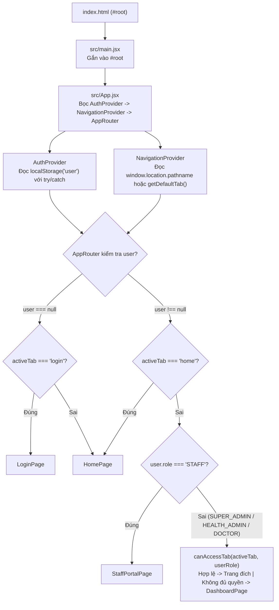
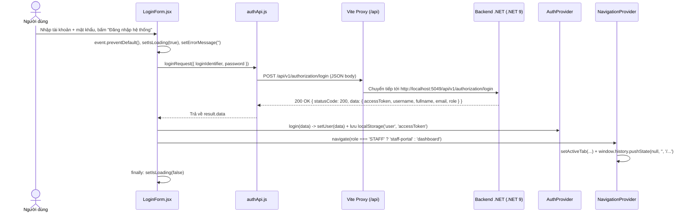
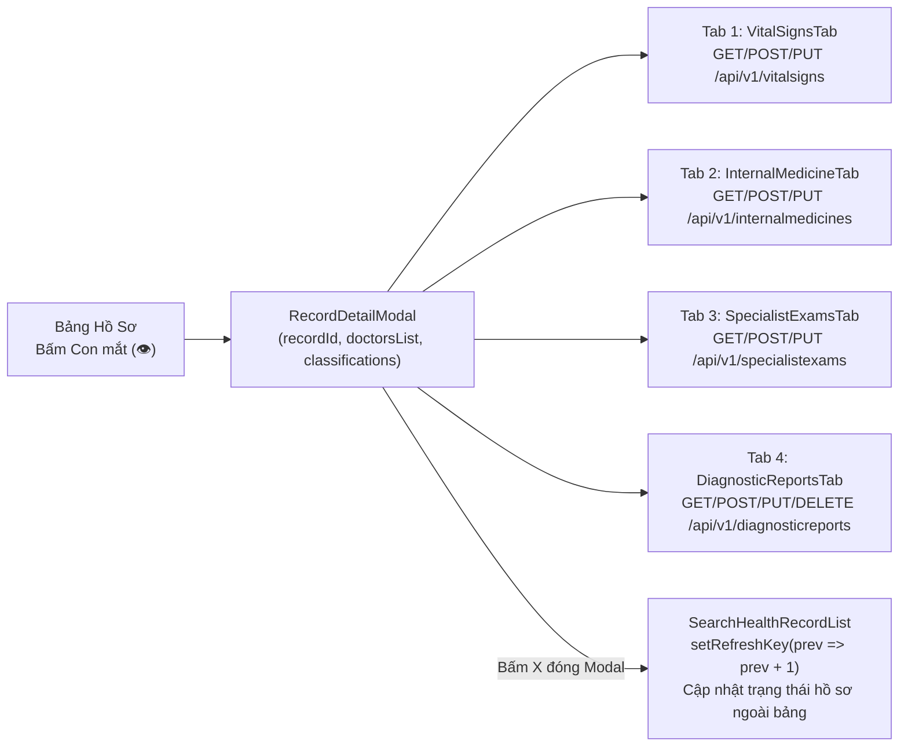

# 06. Mô Tả Chi Tiết Luồng Hoạt Động Toàn Bộ Hệ Thống (End-to-End)

> Tài liệu truy vết chính xác **từng bước hoạt động thực tế** trong mã nguồn `VnuaCare-UI` — từ thao tác bấm chuột của người dùng → state React → Service → HTTP API (`fetch`) → Backend `.NET 9` → SQL Server → cập nhật lại giao diện.

---

## Luồng 1 — Khởi Chạy Ứng Dụng & Khôi Phục Phiên Đăng Nhập

Khi người dùng mở trình duyệt và truy cập `http://localhost:5173` (hoặc bấm **F5** tải lại trang):

### Chi tiết từng bước trong code:
1. **`index.html` → `src/main.jsx`:** Nạp `src/index.css` và render `<App />` vào thẻ `
`.
2. **`src/core/contexts/AuthProvider.jsx`:** Khởi tạo `user` bằng lazy initializer trong `useState(() => ...)`:
   - Đọc `localStorage.getItem('user')`. Nếu tồn tại thì `JSON.parse()` để khôi phục phiên mà không bị đăng xuất khi F5.
   - Nếu chuỗi JSON bị lỗi/hỏng, khối `catch` tự dọn sạch `user` và `accessToken` rồi trả `null` để ứng dụng không bị trắng trang.
3. **`src/core/contexts/NavigationProvider.jsx`:** Khởi tạo `activeTab` bằng cách đọc `window.location.pathname.replace('/', '').trim()`. Nếu đang ở đường dẫn gốc `/`, hàm `getDefaultTab()` quyết định tab mặc định:
   - Không có `accessToken` → `'home'`
   - Vai trò `STAFF` → `'staff-portal'`
   - Các vai trò quản trị / bác sĩ → `'dashboard'`
4. **`src/app/AppRouter.jsx`:** Nhận `user` từ `useAuth()` và `activeTab` từ `useNavigation()` để quyết định render đúng 1 trang duy nhất.

---

## Luồng 2 — Đăng Nhập Hệ Thống, Cấp JWT & Điều Hướng Theo Vai Trò

### Xử lý tình huống lỗi:
- Nếu sai mật khẩu / tài khoản bị khóa: Backend trả mã lỗi kèm `message`, `authApi.js` ném `throw new Error(result.message)`, khối `catch` ở `LoginForm.jsx` gán vào `errorMessage` để hiện khung cảnh báo đỏ ngay trên form.
- Nếu chưa bật Backend hoặc sai cổng trong `vite.config.js`: Vite Proxy trả `502 Bad Gateway`.

---

## Luồng 3 — Điều Hướng SPA, Thu Gọn Sidebar & Kiểm Soát Phân Quyền (RBAC)

1. **Hiển thị Menu (`Sidebar.jsx`):**
   - Đọc `userRole = (user?.role || '').toUpperCase()` từ `useAuth()`.
   - Lọc `MENU_ITEMS.filter((item) => !item.roles || item.roles.includes(userRole))`:
     - `SUPER_ADMIN`: hiện đủ 6 mục (`dashboard`, `records`, `staffs`, `doctors`, `users`, `settings`).
     - `HEALTH_ADMIN`: ẩn mục `users` (5 mục).
     - `DOCTOR`: chỉ hiện 3 mục (`dashboard`, `records`, `settings`).
2. **Bấm chuyển trang:**
   - Bấm nút trên `Sidebar` → gọi `navigate(id)` → `NavigationProvider` chạy `setActiveTab(id)` và `window.history.pushState(null, '', '/' + id)` → `AppRouter` kiểm tra `canAccessTab(activeTab, userRole)` rồi render trang mới bên trong `MainLayout`.
   - Khi người dùng bấm nút **Back / Forward** của trình duyệt, sự kiện `window.addEventListener('popstate', ...)` trong `NavigationProvider` tự đọc lại `window.location.pathname` để cập nhật lại `activeTab`.
3. **Thu gọn / Mở rộng Sidebar (`MainLayout.jsx`):**
   - Khởi tạo `sidebarCollapsed` từ `localStorage.getItem('sidebarCollapsed') === 'true'`.
   - Bấm nút mũi tên `<` / `>` → `handleToggleSidebar()` đảo giá trị và lưu ngược vào `localStorage`, đồng thời gắn/gỡ class CSS `.collapsed` (`248px` ↔ `72px`).

---

## Luồng 4 — Tải & Hiển Thị Số Liệu Thời Gian Thực Trên Dashboard

Tại `DashboardPage.jsx` → `DashboardManager.jsx`:

1. **Kích hoạt tải dữ liệu:** `useEffect(..., [refreshKey])` tự động chạy ngay khi mở Dashboard (và chạy lại mỗi khi người dùng bấm nút **"Làm mới số liệu"** làm tăng `refreshKey`).
2. **Gọi 4 nguồn API độc lập (mỗi khối có `try/catch` riêng để 1 API lỗi không làm sập cả trang):**
   - `StaffService.getStaffs({ pageNumber: 1, pageSize: 1 })` → `POST /api/v1/staffs/filter` → lấy `staffRes?.totalCount` lưu vào `totalStaffs`.
   - `DoctorService.getDoctors({ pageNumber: 1, pageSize: 1 })` → `POST /api/v1/doctors/filter` → lấy `doctorRes?.totalCount` lưu vào `totalDoctors`.
   - `HealthRecordService.getHealthRecords({ pageNumber: 1, pageSize: 200 })` → `POST /api/v1/healthcheckuprecords/filter` → lấy `recordRes?.totalCount` lưu vào `totalRecords` và `recordRes?.items` lưu vào `records`.
   - `HealthRecordService.getCampaigns()` → `GET /api/v1/campaigns/select` → lấy `campaignList.length` lưu vào `totalCampaigns`.
3. **Render 3 khối hiển thị từ cùng nguồn state:**
   - **Khối 4 thẻ KPI:** Ánh xạ `statsById = { staffs, doctors, records, campaigns }` lên cấu hình tĩnh `STAT_CARDS`. Kiểm tra `canNavigateTo(card.targetTab)` — nếu vai trò hiện tại được phép, bấm thẻ sẽ gọi `navigate(card.targetTab)`.
   - **Khối Biểu đồ thanh ngang (`DashboardStatsCharts`):** Nhận `props` `{ records, loading }`:
     - Khung trái: duyệt `DEFAULT_HEALTH_CLASSIFICATIONS` + mục `'Chưa xếp loại'`, dùng `matchesClassification()` đếm số hồ sơ từng loại và `calculatePercent()` tính chiều rộng thanh `%`.
     - Khung phải: đếm theo 4 trạng thái `COMPLETED`, `IN_PROGRESS`, `PENDING`, `CANCELLED` dùng nhãn từ `RECORD_STATUS_LABELS`.
   - **Khối Bảng gần đây (`DashboardRecentRecords`):** Nhận `{ records, loading, onViewAll }`, cắt `records.slice(0, 5)`, định dạng ngày bằng `formatDate()` và hiện nút *"Xem tất cả hồ sơ →"* nếu đủ quyền.

---

## Luồng 5 — Quy Trình CRUD, Lọc & Phân Trang Chuẩn Của 4 Phân Hệ Quản Trị

Áp dụng đồng nhất cho **Hồ sơ khám** (`SearchHealthRecordList`), **Cán bộ** (`SearchStaffList`), **Bác sĩ** (`SearchDoctorList`) và **Tài khoản** (`SearchAccountList`):

### Bước A — Tải danh mục tra cứu (Lookups) một lần khi mở màn hình
- `useEffect(..., [])` gọi song song các API danh mục bằng `Promise.allSettled([...])`:
  - Hồ sơ khám: Đợt khám (`getCampaigns`), Khoa/Phòng (`getDepartments`), Phân loại SK (`DEFAULT_HEALTH_CLASSIFICATIONS`), Trạng thái (`DEFAULT_RECORD_STATUSES`), Cán bộ (`getStaffs`), Bác sĩ (`getDoctors`).
  - Cán bộ: Khoa/Phòng (`getDepartments`), Tài khoản vai trò `STAFF` (`getUserSelectApi('STAFF')`).
  - Bác sĩ: Chuyên khoa (`getSpecialties`), Tài khoản vai trò `DOCTOR` (`getUserSelectApi('DOCTOR')`).

### Bước B — Tải bảng theo bộ lọc và phân trang
- `useEffect(..., [search, ...filters, pageNumber, pageSize, refreshKey])`:
  - Khi người dùng gõ từ khóa tìm kiếm hoặc chọn dropdown lọc trên `*Filter.jsx`, callback ở Cha cập nhật state bộ lọc **đồng thời đưa `pageNumber` về `1`** (tránh đang ở trang 3 rồi lọc ra chỉ còn 1 trang bị rỗng).
  - Gọi `POST /api/v1/<module>/filter` kèm JWT Header (`getAuthHeaders()`).
  - Các giá trị `'ALL'` được xử lý sạch trước khi gửi (ở `recordApi.js` bỏ khỏi `bodyData`; ở `staffApi.js` gửi `departmentId: 0`; ở `doctorApi.js` gửi `specialty: 0`).
  - Nhận về `{ items, totalCount }` đã bóc 2 lớp `result?.data?.data` → cập nhật bảng và thanh phân trang trong `*Table.jsx`.

### Bước C — Thêm mới (`CREATE`) & Cập nhật (`EDIT`) qua 1 Modal dùng chung
- **Bấm Thêm mới:** Reset `formData` từ `INITIAL_FORM` (riêng Hồ sơ khám tự sinh sẵn mã `SID-<năm>-<4 số>` và ngày hôm nay), đặt `modalMode = ModelMode.CREATE`.
- **Bấm Sửa (icon Bút chì):** Đổ dữ liệu của dòng `rec` vào `formData`, đặt `modalMode = ModelMode.EDIT`.
- **Bấm Lưu (`handleSubmitForm`):**
  1. Khóa nút (`setSubmitting(true)`), kiểm tra các trường bắt buộc.
  2. Nếu `CREATE` → gọi `POST /api/v1/<module>/add`; nếu `EDIT` → gọi `PUT /api/v1/<module>/update`.
  3. Thành công → đóng Modal (`setModalMode(null)`), gọi `showToast(...)` và tăng `setRefreshKey((prev) => prev + 1)` để bảng tự tải lại dữ liệu mới nhất.
  4. Thất bại → hiện câu lỗi chuẩn hóa từ `parseApiError()` ngay trong Modal (`setModalError`).

### Bước D — Xóa bản ghi có hộp thoại xác nhận
- Bấm icon Thùng rác → lưu thông tin dòng vào `deleting*` để bật hộp thoại xác nhận.
- Bấm xác nhận Xóa → gọi `DELETE /api/v1/<module>/{id}` → đóng hộp thoại, hiện Toast và tăng `refreshKey`.

---

## Luồng 6 — Quy Trình Khám Chuyên Môn 4 Tab (`RecordDetailModal.jsx`)

Từ bảng Hồ sơ khám, bấm nút **Con mắt (👁️)** trên 1 dòng → `setViewingRecord(record)` mở `RecordDetailModal`:

### Luồng chi tiết từng Tab:
1. **Tab 1 — Thể lực & Sinh tồn (`VitalSignsTab.jsx`):**
   - Mở tab → `useEffect([recordId])` gọi `GET /api/v1/vitalsigns/{recordId}` đổ vào `formData`.
   - Khi gõ Chiều cao / Cân nặng → `handleHeightWeightChange` tự tính `bmi = (w / (m * m)).toFixed(2)` → `evaluateBmi()` hiện nhãn màu thể trạng tức thì.
   - Khi gõ Huyết áp tâm thu / tâm trương → `evaluateBloodPressure()` hiện nhãn cảnh báo huyết áp tức thì.
   - Bấm Lưu → nếu đã có `vitalSignId` gọi `PUT /update`, ngược lại gọi `POST /add`.
2. **Tab 2 — Khám Nội khoa (`InternalMedicineTab.jsx`):**
   - Mở tab → gọi `GET /api/v1/internalmedicines/{recordId}`.
   - Tự chia dropdown Bác sĩ thành 2 nhóm: *Bác sĩ Nội tổng quát (`specialtyId === 1`)* lên trên và *Bác sĩ chuyên khoa khác* bên dưới.
   - Nhập 6 hệ cơ quan + kết luận + xếp loại nội khoa → Lưu (`PUT /update` nếu đã có `internalExamId`, ngược lại `POST /add`).
3. **Tab 3 — Chuyên khoa lẻ (`SpecialistExamsTab.jsx`):**
   - Mở tab → gọi song song `GET /api/v1/specialistexams/{recordId}` và `GET /api/v1/doctors/specialties`.
   - Ánh xạ kết quả từng khoa vào `examsMap[code]` (`EYE`, `ENT`, `DENTAL`, `DERMATOLOGY`, `SURGERY`, `OBSTETRICS`).
   - Khi bác sĩ gõ vào khoa nào → cập nhật `examsMap[code]` và đánh dấu mã khoa đó vào mảng `unsavedCodes` (cột trái hiện `● Chưa lưu`).
   - Khi bấm Lưu khoa `savingCode` → chỉ đóng gói các trường thuộc đúng khoa đó gửi `POST /add` hoặc `PUT /update` → tải lại danh sách từ DB, xóa `savingCode` khỏi `unsavedCodes` và **giữ nguyên nháp chưa lưu** của các khoa khác trong `examsMap`.
4. **Tab 4 — Chẩn đoán hình ảnh & Thăm dò chức năng (`DiagnosticReportsTab.jsx`):**
   - Mở tab → `diagnosticReportService.getReportsByRecordId(recordId)` gọi `GET /api/v1/diagnosticreports/{recordId}`, chuyển từng bản ghi qua `DiagnosticReport.fromApi()` (giải mã chuỗi JSON `findings_data` thành mảng `FindingSection[]`) và **sắp xếp cố định theo `reportId` tăng dần**.
   - Giao diện quản lý bằng **1 mảng `reports` duy nhất** + **1 khóa `selectedKey`** (`clientKey`).
   - **Bấm "+ Thêm phiếu":** `DiagnosticReport.createBlank()` tạo phiếu trống có `clientKey` duy nhất và giờ địa phương `formatLocalDateTimeInput()`, nối vào đầu mảng `reports` và chọn `selectedKey` vào nó (tạo được nhiều phiếu mới liên tiếp không đè phiếu cũ).
   - **Chỉnh sửa vùng mô tả / gạch đầu dòng:** `updateCurrentReport()` chỉ clone và cập nhật đúng phần tử có `clientKey === selectedKey` trong `reports`.
   - **Bấm "Lưu kết quả CĐHA":** `selectedReport.validate()` kiểm tra tiêu đề & kết luận → `toApiPayload()` đóng gói lại thành chuỗi JSON `findingsEnvelope` kèm giờ địa phương `YYYY-MM-DDTHH:mm:ss` → gọi `POST /add` hoặc `PUT /update` → tải lại danh sách DB, giữ lại các phiếu nháp chưa lưu khác và giữ `selectedKey` đứng yên ở đúng phiếu vừa lưu.
   - **Bấm "Xóa phiếu này" / "Hủy phiếu nháp":** Nếu là phiếu nháp chưa có `reportId` thì gỡ ngay khỏi `reports`; nếu đã lưu DB thì xác nhận rồi gọi `DELETE /api/v1/diagnosticreports/{reportId}`.
5. **Đóng cửa sổ khám:** Khi bấm nút `X`, `SearchHealthRecordList.jsx` đóng `RecordDetailModal` và tăng `refreshKey` để bảng ngoài tự cập nhật trạng thái hồ sơ (ví dụ từ `Chờ khám` sang `Đang khám`).

---

## Luồng 7 — Cài Đặt Tài Khoản Cá Nhân, Đổi Mật Khẩu & Đăng Xuất

### 7.1. Cập nhật Hồ sơ cá nhân (`Settings.jsx` — Tab 1)
1. Mở trang Cài đặt → `useEffect([refreshKey])` gọi `AccountService.getMyProfile()` (`GET /api/v1/users/me`).
2. Hiển thị thông tin định danh chỉ đọc (Tên đăng nhập, Vai trò tiếng Việt từ `ROLE_LABELS`, Mã bác sĩ / Mã cán bộ) và đổ `fullName`, `email` vào `profileForm`.
3. Bấm **"Lưu thông tin cá nhân"** → gọi `AccountService.updateMyProfile()` (`PUT /api/v1/users/profile`).
4. Ngay sau khi Backend trả thành công → gọi lại `AuthProvider.login({ ...user, fullName, fullname, email })` để tên và email trên `Header` cập nhật ngay lập tức không cần F5, sau đó hiện Toast và tăng `refreshKey`.

### 7.2. Đổi mật khẩu (`Settings.jsx` — Tab 2)
1. Nhập mật khẩu hiện tại, mật khẩu mới và xác nhận mật khẩu mới.
2. Kiểm tra tại chỗ 4 điều kiện: nhập đủ 3 ô, mật khẩu mới $\ge 6$ ký tự, khớp mật khẩu xác nhận, không trùng mật khẩu cũ.
3. Gọi `AccountService.changePassword()` (`POST /api/v1/users/change-password`) → thành công thì xóa trắng 3 ô input và hiện Toast.

### 7.3. Đăng xuất (`Header.jsx` / `StaffPortalPage.jsx`)
- Bấm nút **"Đăng xuất"** → gọi `logout()` xóa sạch `user` trong state và xóa `user`, `accessToken` trong `localStorage` → gọi `navigate('home')` đưa về Trang chủ (nếu cố truy cập lại `/dashboard` sẽ bị `AppRouter` chặn về `HomePage`).
