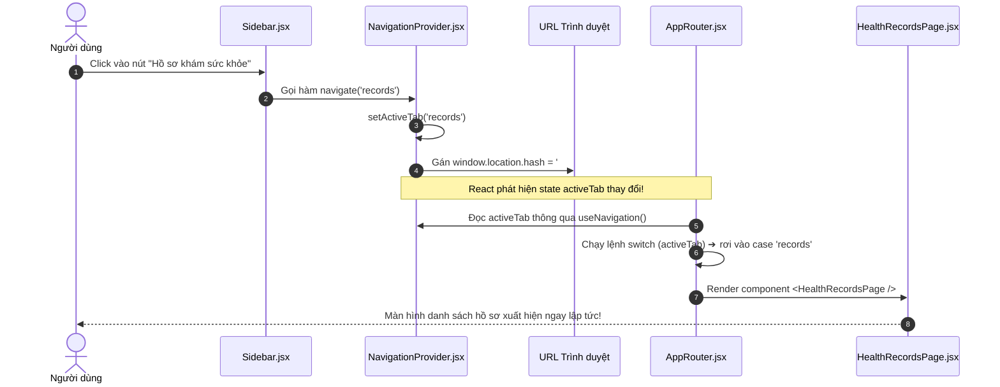
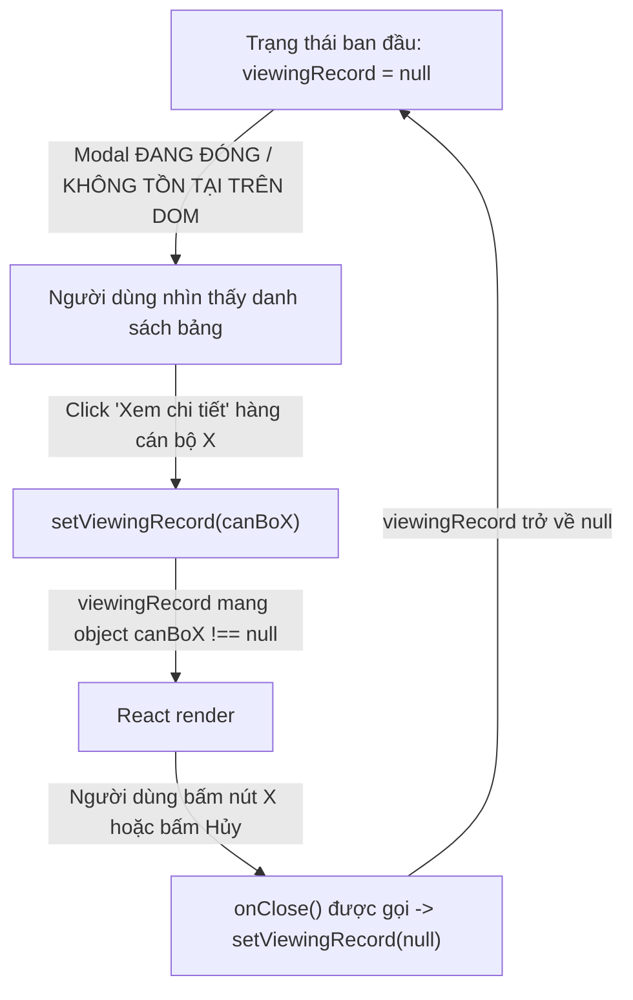
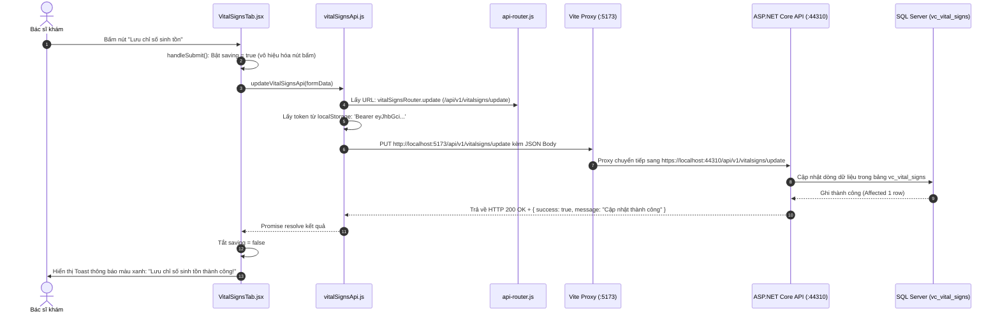

# CẨM NANG CHI TIẾT: CƠ CHẾ SỰ KIỆN, ĐIỀU HƯỚNG & LUỒNG DỮ LIỆU TOÀN BỘ VNUACARE-UI

> **Mục tiêu:** Hướng dẫn chi tiết đến từng dòng code về cách ứng dụng nhận sự kiện (click, change, submit), cơ chế đổi trang không cần reload (SPA), luồng mở/đóng modal, cách dữ liệu form truyền từ giao diện xuống CSDL và ngược lại.
> **Dành cho:** Lập trình viên muốn hiểu cặn kẽ 100% cách thức hoạt động của toàn bộ hệ thống.

---

## MỤC LỤC

1. [Bản Chất Cốt Lõi: React SPA Hoạt Động Như Thế Nào?](#1-bản-chất-cốt-lõi-react-spa-hoạt-động-như-thế-nào)
2. [Cơ Chế 1: Luồng Đổi Trang (Navigation Flow) Chi Tiết](#2-cơ-chế-1-luồng-đổi-trang-navigation-flow-chi-tiết)
3. [Cơ Chế 2: Luồng Bật / Tắt Cửa Sổ Modal (Modal Visibility Flow)](#3-cơ-chế-2-luồng-bật--tắt-cửa-sổ-modal-modal-visibility-flow)
4. [Cơ Chế 3: Luồng Chuyển Đổi 5 Tab Khám Chuyên Môn](#4-cơ-chế-3-luồng-chuyển-đổi-5-tab-khám-chuyên-môn)
5. [Cơ Chế 4: Luồng Gõ Phím & Nhập Liệu Form (Two-Way Binding)](#5-cơ-chế-4-luồng-gõ-phím--nhập-liệu-form-two-way-binding)
6. [Cơ Chế 5: Chu Trình Bấm Nút "Lưu" & Giao Tiếp API Toàn Diện](#6-cơ-chế-5-chu-trình-bấm-nút-lưu--giao-tiếp-api-toàn-diện)
7. [Cơ Chế 6: Giao Tiếp Cha - Con (Props Down, Events Up)](#7-cơ-chế-6-giao-tiếp-cha---con-props-down-events-up)
8. [Hướng Dẫn Thực Hành: Tự Thêm 1 Nút Bấm Có Sự Kiện Mới Từ A Đến Z](#8-hướng-dẫn-thực-hành-tự-thêm-1-nút-bấm-có-sự-kiện-mới-từ-a-đến-z)

---

## 1. BẢN CHẤT CỐT LÕI: REACT SPA HOẠT ĐỘNG NHƯ THẾ NÀO?

Trước khi đi vào từng nút bấm, bạn cần hiểu nguyên tắc số 1 của **SPA (Single Page Application - Ứng dụng Trang Đơn)**:

* **Web truyền thống (PHP, ASP.NET MVC cũ, HTML thuần):**  
  Mỗi lần bạn click một đường link, trình duyệt gửi yêu cầu lên server, màn hình nháy trắng một cái, và tải về một trang HTML mới toanh.
* **React SPA (VnuaCare-UI):**  
  Trình duyệt **CHỈ TẢI ĐÚNG 1 FILE `index.html` DUY NHẤT** khi bạn mở web.  
  Tất cả những việc như: "đổi trang", "mở modal", "chuyển tab" thực chất **KHÔNG HỀ TẢI LẠI TRANG**. Nó chỉ là:
  > **Thay đổi một biến State ➔ React phát hiện biến thay đổi ➔ Ẩn component A đi và Hiện component B ra.**

Toàn bộ sự kiện trên web đều tuân theo công thức bất biến:
$$\text{Sự kiện người dùng (Click/Gõ)} \longrightarrow \text{Cập nhật State} \longrightarrow \text{Giao diện tự động vẽ lại}$$

---

## 2. CƠ CHẾ 1: LUỒNG ĐỔI TRANG (NAVIGATION FLOW) CHI TIẾT

Đây là quy trình xảy ra khi người dùng đang ở trang **Tổng quan (Dashboard)** và bấm vào nút **"Hồ sơ khám sức khỏe"** trên Sidebar bên trái:



### Truy vết chi tiết từng dòng code:

#### Bước 1: Khởi nguồn từ nút bấm trên Sidebar
* **File:** [`src/core/layouts/components/Sidebar.jsx`](file:///c:/Users/Admin/Documents/GitHub/VnuaCare-UI/src/core/layouts/components/Sidebar.jsx)
* **Dòng code:**
  ```jsx
  // Lấy hàm navigate từ Context ra dùng
  const { activeTab: currentTab, navigate } = useNavigation();

  // Khi duyệt danh sách menu từ menuNavData.js:
  <button 
    type="button" 
    className={`nav-link ${active === id ? 'active' : ''}`} 
    onClick={() => navigate(id)}  // <-- SỰ KIỆN CLICK BẮT ĐẦU TẠI ĐÂY
  >
    <Icon className="nav-icon" size={19} />
    <span className="nav-text">{label}</span>
  </button>
  ```
* Khi click nút có `id = 'records'`, hàm `navigate('records')` được kích hoạt.

#### Bước 2: Xử lý bên trong `NavigationProvider`
* **File:** [`src/core/contexts/NavigationProvider.jsx`](file:///c:/Users/Admin/Documents/GitHub/VnuaCare-UI/src/core/contexts/NavigationProvider.jsx)
* **Dòng code:**
  ```jsx
  export function NavigationProvider({ children }) {
    // 1. Biến activeTab lưu trữ tên trang hiện tại (mặc định là 'dashboard')
    const [activeTab, setActiveTab] = useState(() => {
      const hash = window.location.hash.replace('#/', '').replace('#', '');
      return hash || 'dashboard';
    });

    // 2. Hàm navigate được gọi khi bấm nút ở Sidebar
    const navigate = (tabId) => {
      setActiveTab(tabId);               // Đổi state React: activeTab = 'records'
      window.location.hash = `#/${tabId}`;  // Đồng bộ thanh địa chỉ: localhost:5173/#/records
    };

    // 3. Cung cấp activeTab và navigate cho TOÀN BỘ ứng dụng
    return (
      <NavigationContext.Provider value={{ activeTab, navigate }}>
        {children}
      </NavigationContext.Provider>
    );
  }
  ```

#### Bước 3: `AppRouter` nhận tín hiệu và đổi trang
* **File:** [`src/app/AppRouter.jsx`](file:///c:/Users/Admin/Documents/GitHub/VnuaCare-UI/src/app/AppRouter.jsx)
* **Dòng code:**
  ```jsx
  function AppRouter() {
    const { user } = useAuth();
    const { activeTab } = useNavigation(); // Đọc activeTab vừa đổi thành 'records'

    if (!user) return <LoginPage />;

    // switch...case đọc activeTab để render đúng trang:
    switch (activeTab) {
      case 'doctors':
        return <DoctorManagerPage />;
      case 'records':
        return <HealthRecordsPage />;   // <-- Khớp case 'records' ➔ Trả về trang này!
      case 'staffs':
        return <StaffManagerPage />;
      default:
        return <DashboardPage />;
    }
  }
  ```

---

## 3. CƠ CHẾ 2: LUỒNG BẬT / TẮT CỬA SỔ MODAL

*(Áp dụng cho: Modal xem chi tiết hồ sơ, Modal thêm mới cán bộ, Modal xóa...)*

Trong React, **không có khái niệm "mở cửa sổ" như desktop**. Một Modal hiển thị hay ẩn đi phụ thuộc hoàn toàn vào một biến State mang giá trị `null` hoặc `Object`.



### Mã nguồn thực tế tại [`HealthRecordsPage.jsx`](file:///c:/Users/Admin/Documents/GitHub/VnuaCare-UI/src/pages/health-records/HealthRecordsPage.jsx):

```jsx
export default function HealthRecordsPage() {
  // 1. Biến nhớ: Cán bộ nào đang được chọn để xem chi tiết? (mặc định null = không có ai)
  const [viewingRecord, setViewingRecord] = useState(null);

  return (
    <div>
      {/* 2. Bảng danh sách: Mỗi hàng có nút "Xem chi tiết" */}
      {records.map((rec) => (
        <tr key={rec.recordId}>
          <td>{rec.staffName}</td>
          <td>
            {/* Khi click: nhét toàn bộ thông tin cán bộ rec vào viewingRecord */}
            <button 
              type="button" 
              className="btn btn-outline-primary"
              onClick={() => setViewingRecord(rec)} // <-- MỞ MODAL TẠI ĐÂY
            >
              Xem chi tiết
            </button>
          </td>
        </tr>
      ))}

      {/* 3. ĐIỀU KIỆN RENDER: Nếu viewingRecord khác null THÌ MỚI VẼ MODAL */}
      {viewingRecord && (
        <RecordDetailModal 
          record={viewingRecord} 
          onClose={() => setViewingRecord(null)} // <-- ĐÓNG MODAL: Đưa viewingRecord về null!
          onRefreshList={loadData}               // Báo cha tải lại bảng khi con lưu xong
        />
      )}
    </div>
  );
}
```

* Khi bấm nút **"Xem chi tiết"**: `setViewingRecord(rec)` ➔ `viewingRecord` có dữ liệu ➔ Thẻ `<RecordDetailModal>` được vẽ lên màn hình.
* Khi bấm nút **✕** trên Modal: Modal gọi `onClose()` ➔ Hàm `() => setViewingRecord(null)` chạy ➔ `viewingRecord` thành `null` ➔ Biểu thức `{viewingRecord && ...}` trả về `false` ➔ Modal biến mất hoàn toàn khỏi màn hình!

---

## 4. CƠ CHẾ 3: LUỒNG CHUYỂN ĐỔI 5 TAB KHÁM CHUYÊN MÔN

Khi đã mở cửa sổ `RecordDetailModal`, bác sĩ cần chuyển đổi giữa 5 Tab khám:
1. Thể Lực & Dấu Hiệu Sinh Tồn (`VITAL_SIGNS`)
2. Khám Nội Khoa (`INTERNAL_MEDICINE`)
3. Khám Chuyên Khoa Lẻ (`SPECIALIST_EXAMS`)
4. CĐHA & Thăm Dò Chức Năng (`DIAGNOSTIC_REPORTS`)
5. Kết Luận & Xếp Loại (`CONCLUSION`)

Cơ chế này nằm trọn vẹn trong file [`RecordDetailModal.jsx`](file:///c:/Users/Admin/Documents/GitHub/VnuaCare-UI/src/features/health-records/components/RecordDetailModal.jsx):

```jsx
export default function RecordDetailModal({ record, onClose, onRefreshList }) {
  // 1. State lưu tab nào đang mở (mặc định tab 1: 'VITAL_SIGNS')
  const [activeTab, setActiveTab] = useState('VITAL_SIGNS');

  return (
    <div className="modal-overlay">
      <div className="record-detail-modal">
        {/* HEADER MODAL */}
        <div className="record-detail-header">
          <h3>{record.staffName}</h3>
          <button onClick={onClose}>✕</button>
        </div>

        {/* THANH CHỌN TAB: Bấm nút nào thì đổi activeTab thành chữ đó */}
        <div className="record-tabs-bar">
          <button 
            className={`record-tab-btn ${activeTab === 'VITAL_SIGNS' ? 'active' : ''}`}
            onClick={() => setActiveTab('VITAL_SIGNS')}
          >
            1. Thể Lực & Sinh Tồn
          </button>

          <button 
            className={`record-tab-btn ${activeTab === 'INTERNAL_MEDICINE' ? 'active' : ''}`}
            onClick={() => setActiveTab('INTERNAL_MEDICINE')}
          >
            2. Khám Nội Khoa
          </button>

          <button 
            className={`record-tab-btn ${activeTab === 'DIAGNOSTIC_REPORTS' ? 'active' : ''}`}
            onClick={() => setActiveTab('DIAGNOSTIC_REPORTS')}
          >
            4. CĐHA & Thăm Dò
          </button>
        </div>

        {/* NỘI DUNG BODY: Chỉ render DUY NHẤT component có tab tương ứng */}
        <div className="record-detail-body">
          {activeTab === 'VITAL_SIGNS' && (
            <VitalSignsTab recordId={record.recordId} />
          )}

          {activeTab === 'INTERNAL_MEDICINE' && (
            <InternalMedicineTab recordId={record.recordId} />
          )}

          {activeTab === 'DIAGNOSTIC_REPORTS' && (
            <DiagnosticReportsTab recordId={record.recordId} />
          )}
        </div>
      </div>
    </div>
  );
}
```

> **Điểm ưu việt:** Modal cha không hề bị load lại. Khi bạn bấm Tab 2, chỉ có vùng `record-detail-body` thay thế component con bên trong, header thông tin bệnh nhân vẫn giữ nguyên cố định!

---

## 5. CƠ CHẾ 4: LUỒNG GÕ PHÍM & NHẬP LIỆU FORM (TWO-WAY BINDING)

Khi bạn gõ chữ vào ô Chiều cao, Cân nặng, Kết luận... làm sao React biết bạn gõ gì và lưu vào đâu?

Ví dụ trong [`VitalSignsTab.jsx`](file:///c:/Users/Admin/Documents/GitHub/VnuaCare-UI/src/features/health-records/tabs/vital-signs/VitalSignsTab.jsx):

```jsx
// 1. Khởi tạo State chứa toàn bộ thông tin form sinh tồn:
const [formData, setFormData] = useState({
  heightCm: '',
  weightKg: '',
  systolicBp: '',
  diastolicBp: '',
  heartRateBpm: ''
});

// 2. Ô input nhập Chiều cao:
<input
  type="number"
  className="form-input"
  value={formData.heightCm}  // <-- Luồng 1: State truyền xuống hiển thị lên ô input
  onChange={(event) => {     // <-- Luồng 2: Khi người dùng gõ phím, sự kiện onChange kích hoạt
    const giaTriMoi = event.target.value; // Lấy chữ vừa gõ
    setFormData({
      ...formData,           // Giữ nguyên các trường khác (cân nặng, huyết áp...)
      heightCm: giaTriMoi    // Chỉ ghi đè trường heightCm bằng giá trị mới!
    });
  }}
/>
```

### Tại sao phải có dấu 3 chấm `...formData` (Spread Operator)?
Nếu bạn viết: `setFormData({ heightCm: 170 })` mà không có `...formData`, toàn bộ các trường `weightKg`, `systolicBp`... sẽ **bị xóa sạch** và object chỉ còn trơ trọi đúng `heightCm`!  
Dấu `...formData` có nghĩa là: *"Hãy sao chép lại toàn bộ dữ liệu cũ, tôi chỉ muốn cập nhật đúng 1 ô tôi đang gõ thôi!"*.

---

## 6. CƠ CHẾ 5: CHU TRÌNH BẤM NÚT "LƯU" & GIAO TIẾP API TOÀN DIỆN

Đây là quy trình quan trọng nhất: Từ lúc bác sĩ bấm nút **"Lưu chỉ số sinh tồn"** cho đến khi dữ liệu chui vào SQL Server và báo Toast thành công.



### Xem trực tiếp hàm xử lý tại [`VitalSignsTab.jsx`](file:///c:/Users/Admin/Documents/GitHub/VnuaCare-UI/src/features/health-records/tabs/vital-signs/VitalSignsTab.jsx):

```jsx
const handleSubmit = async (e) => {
  e.preventDefault(); // Ngăn trình duyệt reload trang

  // BƯỚC 1: Bật trạng thái loading -> Nút bấm đổi thành "Đang lưu..." và bị mờ đi
  setSaving(true);
  setError('');

  try {
    // BƯỚC 2: Kiểm tra xem đã có ID chưa để chọn gọi API Tạo mới (POST) hay Cập nhật (PUT)
    if (formData.vitalSignId) {
      await updateVitalSignsApi(formData);
    } else {
      await createVitalSignsApi({ ...formData, recordId });
    }

    // BƯỚC 3: Nếu thành công -> Bắn thông báo Toast
    if (showToast) {
      showToast('Lưu chỉ số sinh tồn thành công!');
    }
  } catch (err) {
    // BƯỚC 4: Nếu có lỗi (mất mạng, server chết...) -> Hiện thông báo đỏ
    setError(err.message || 'Lỗi khi lưu chỉ số sinh tồn');
  } finally {
    // BƯỚC 5: Luôn luôn tắt loading dù thành công hay thất bại
    setSaving(false);
  }
};
```

---

## 7. CƠ CHẾ 6: GIAO TIẾP CHA - CON (PROPS DOWN, EVENTS UP)

Một trong những câu hỏi phổ biến nhất: *"Tab con nằm tít bên trong Modal, làm sao khi lưu xong nó bảo được Bảng danh sách ở ngoài tải lại dữ liệu mới?"*

Nguyên lý vàng của React: **Props truyền dữ liệu từ Cha xuống Con, còn Event Callback bắn tín hiệu từ Con ngược lên Cha.**

```
[HealthRecordsPage.jsx (Cha)]
     │
     │  (1) Cha truyền hàm loadData xuống qua prop: onRefreshList={loadData}
     ▼
[RecordDetailModal.jsx (Con)]
     │
     │  (2) Con chuyển tiếp hàm đó xuống Tab: onRecordUpdated={onRefreshList}
     ▼
[GeneralConclusionTab.jsx (Cháu)]
     │
     │  (3) Cháu bấm nút "Lưu kết luận" thành công!
     │  (4) Cháu gọi: onRecordUpdated()
     ▼
[Kích hoạt hàm loadData() của Cha ở ngoài cùng tự động chạy lại!]
```

### Code đối chiếu:

1. **Ở Cha ([HealthRecordsPage.jsx](file:///c:/Users/Admin/Documents/GitHub/VnuaCare-UI/src/pages/health-records/HealthRecordsPage.jsx)):**
   ```jsx
   const loadData = () => {
     // Hàm này gọi API lấy danh sách hồ sơ mới nhất từ backend
     getHealthRecordFilterApi(...).then(res => setRecords(res.items));
   };

   // Truyền hàm loadData cho con:
   <RecordDetailModal onRefreshList={loadData} />
   ```

2. **Ở Con ([RecordDetailModal.jsx](file:///c:/Users/Admin/Documents/GitHub/VnuaCare-UI/src/features/health-records/components/RecordDetailModal.jsx)):**
   ```jsx
   export default function RecordDetailModal({ onRefreshList }) {
     // Khi truyền tiếp cho Tab 5:
     <GeneralConclusionTab onRecordUpdated={onRefreshList} />
   }
   ```

3. **Ở Cháu ([GeneralConclusionTab.jsx](file:///c:/Users/Admin/Documents/GitHub/VnuaCare-UI/src/features/health-records/tabs/general-conclusion/GeneralConclusionTab.jsx)):**
   ```jsx
   const handleSave = async () => {
     await updateHealthRecordApi(formData); // Lưu xong
     
     if (onRecordUpdated) {
       onRecordUpdated(); // <-- KÍCH BỘ ĐÀM: Bảng danh sách bên ngoài tự tải lại!
     }
   };
   ```

---

## 8. HƯỚNG DẪN THỰC HÀNH: TỰ THÊM 1 NÚT BẤM CÓ SỰ KIỆN MỚI TỪ A ĐẾN Z

Bây giờ bạn hãy thử tưởng tượng: **Bạn muốn thêm 1 nút "In Phiếu Khám" (Print) trên Modal**. Bạn chỉ cần làm đúng **3 bước cực dễ**:

### Bước 1: Viết hàm xử lý sự kiện trong Component
```jsx
// Trong RecordDetailModal.jsx:
const handlePrintRecord = () => {
  // Lấy mã hồ sơ và mở cửa sổ in ấn của trình duyệt
  window.print();
};
```

### Bước 2: Gắn hàm đó vào nút bấm bằng thuộc tính `onClick`
```jsx
<button 
  type="button" 
  className="btn btn-secondary" 
  onClick={handlePrintRecord} // <-- Gắn sự kiện vào đây
>
  🖨 In phiếu khám
</button>
```

### Bước 3: Xem kết quả!
Khi người dùng click vào nút, trình duyệt lập tức mở hộp thoại Print xem trước bản in.  
Tất cả các nút bấm khác (Xóa, Sửa, Lọc, Xuất Excel...) đều làm y hệt như vậy!

---

## TỔNG KẾT BẢNG TRA CỨU NHANH CÁC SỰ KIỆN PHỔ BIẾN

| Sự kiện React | Khi nào kích hoạt? | Cú pháp mẫu | Mục đích sử dụng |
|---|---|---|---|
| **`onClick`** | Khi click chuột vào phần tử | `onClick={() => doSomething()}` | Chuyển trang, mở modal, bấm nút Lưu, nút Xóa |
| **`onChange`** | Khi giá trị ô nhập thay đổi | `onChange={(e) => setVal(e.target.value)}` | Nhập chữ vào Input, chọn Dropdown, tick Checkbox |
| **`onSubmit`** | Khi gửi dữ liệu form | `<form onSubmit={handleSubmit}>` | Bấm Enter hoặc bấm nút Submit trong form |
| **`useEffect`** | Tự động chạy khi mở màn hình | `useEffect(() => { loadData(); }, [])` | Gọi API tải dữ liệu ngay khi vừa mở trang |

---

*Tài liệu được biên soạn độc quyền cho dự án VnuaCare-UI.*  
*Lưu trữ tại:* `c:\Users\Admin\Documents\GitHub\VnuaCare-UI\docs\CO_CHE_SU_KIEN_VA_DIEU_HUONG_CHI_TIET.md`
