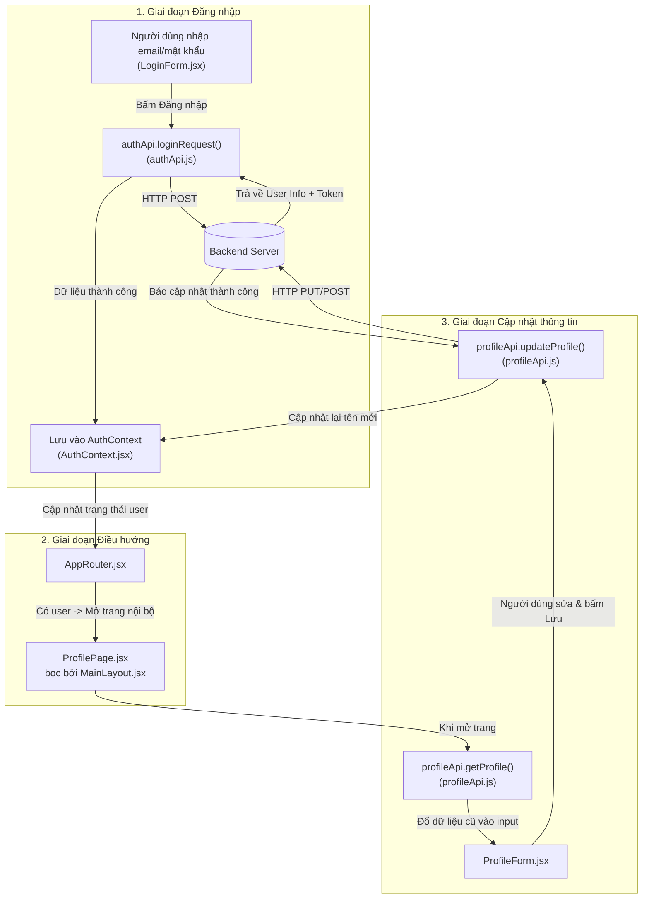

# Hướng dẫn chi tiết: Luồng Đăng nhập & Cập nhật thông tin (VnuaCare UI)

Tài liệu này giải thích chi tiết quy trình xây dựng hai chức năng liên tiếp:
1. **Đăng nhập (Authentication)**: Gửi thông tin đăng nhập, nhận phản hồi và lưu phiên làm việc.
2. **Cập nhật thông tin (Update Profile)**: Sau khi đăng nhập, chuyển vào trang bên trong, hiển thị dữ liệu hiện tại và cập nhật thông tin cá nhân.

---

## 1. Tư duy thực tế (Bức tranh đời thực)

Để không bị bối rối giữa các thư mục `api`, `context`, `components`, `pages`, hãy hình dung quy trình như việc ra vào một tòa nhà:

* **Cổng bảo vệ (`LoginForm.jsx`):** Bạn điền thông tin và nộp thẻ.
* **Người đối chiếu an ninh (`authApi.js`):** Mang thông tin của bạn vào phòng máy chủ để xác thực.
* **Thẻ đeo nội bộ (`AuthContext.jsx`):** Khi xác thực thành công, bạn được cấp một chiếc thẻ đeo (chứa mã số, họ tên, quyền hạn). Thẻ này được đeo trên người suốt thời gian bạn ở trong tòa nhà.
* **Cửa phân luồng (`AppRouter.jsx`):** Nhìn thấy bạn có thẻ đeo hợp lệ thì mở cửa cho bạn vào sảnh chính (`ProfilePage.jsx`), chưa có thẻ thì giữ bạn lại ở cổng (`LoginPage.jsx`).
* **Bàn làm việc (`ProfileForm.jsx`):** Tại đây bạn xem lại hồ sơ cũ, dùng bút chỉnh sửa số điện thoại, đơn vị công tác rồi bấm nộp.
* **Nhân viên lưu trữ (`profileApi.js`):** Mang hồ sơ đã sửa vào kho lưu lại.

---

## 2. Cây thư mục cần tạo mới và chỉnh sửa

Dưới đây là các file trong dự án, phân loại rõ ràng:

```text
VnuaCare-UI/
├── docs/
│   ├── PROJECT_STRUCTURE.md
│   └── FLOW_AUTH_VA_CAP_NHAT_THONG_TIN.md   # [Tài liệu này]
├── src/
│   ├── app/
│   │   └── AppRouter.jsx                    # [CẦN SỬA] Điều hướng giữa Login và các trang nội bộ
│   ├── layouts/
│   │   ├── MainLayout.jsx                   # [TẠO MỚI] Khung sườn web (Header hiện tên user, nút Đăng xuất)
│   │   └── MainLayout.css                   # [TẠO MỚI] Giao diện Header & Menu
│   ├── features/
│   │   ├── auth/                            # === CHỨC NĂNG ĐĂNG NHẬP ===
│   │   │   ├── api/
│   │   │   │   └── authApi.js               # [TẠO MỚI] Gửi request đăng nhập lên Server
│   │   │   ├── context/
│   │   │   │   └── AuthContext.jsx          # [TẠO MỚI] Quản lý thông tin đăng nhập toàn web
│   │   │   └── components/
│   │   │       ├── LoginForm.jsx            # [CẦN SỬA] Nối sự kiện Submit vào API & Context
│   │   │       └── LoginVisual.jsx          # [ĐÃ CÓ] Panel đồ họa giới thiệu
│   │   │
│   │   └── profile/                         # === CHỨC NĂNG CẬP NHẬT THÔNG TIN ===
│   │       ├── api/
│   │       │   └── profileApi.js            # [TẠO MỚI] Gọi API lấy & cập nhật hồ sơ cá nhân
│   │       └── components/
│   │           ├── ProfileForm.jsx          # [TẠO MỚI] Form hiển thị & sửa họ tên, SĐT, khoa phòng
│   │           └── ProfileForm.css          # [TẠO MỚI] Giao diện form cập nhật
│   │
│   ├── pages/
│   │   ├── auth/
│   │   │   ├── LoginPage.jsx                # [ĐÃ CÓ] Màn hình đăng nhập
│   │   │   └── LoginPage.css                # [ĐÃ CÓ] Giao diện trang đăng nhập
│   │   └── profile/
│   │       ├── ProfilePage.jsx              # [TẠO MỚI] Màn hình trang cá nhân hoàn chỉnh
│   │       └── ProfilePage.css              # [TẠO MỚI] Giao diện trang cá nhân
│   │
│   ├── App.jsx                              # [CẦN SỬA] Bọc AuthProvider quanh ứng dụng
│   ├── main.jsx                             # [ĐÃ CÓ] Khởi động ứng dụng
│   └── index.css                            # [ĐÃ CÓ] Định dạng toàn cục
```

---

## 3. Sơ đồ luồng dữ liệu (Data Flow)



---

## 4. Chi tiết từng file và Code khung mẫu

### Giai đoạn 1: Đăng nhập & Lưu phiên

#### 4.1. File `src/features/auth/api/authApi.js`
* **Nhiệm vụ:** Chỉ làm một việc duy nhất: Gửi email/mật khẩu đến máy chủ backend bằng lệnh `fetch` và trả dữ liệu về.
* **Code khung:**
```javascript
const API_BASE_URL = import.meta.env.VITE_API_BASE_URL || 'http://localhost:5000'

export async function loginRequest({ identifier, password }) {
  const response = await fetch(`${API_BASE_URL}/api/v1/auth/login`, {
    method: 'POST',
    headers: {
      'Content-Type': 'application/json',
    },
    body: JSON.stringify({ identifier, password }),
  })

  const data = await response.json()

  if (!response.ok) {
    throw new Error(data.message || 'Đăng nhập không thành công')
  }

  return data // Giả định trả về: { token: '...', user: { id: 1, name: 'Nguyễn Văn A', email: '...' } }
}
```

#### 4.2. File `src/features/auth/context/AuthContext.jsx`
* **Nhiệm vụ:** Giữ thông tin `user` và `token` trong bộ nhớ ứng dụng và `localStorage` để khi F5 tải lại trang không bị văng ra ngoài.
* **Code khung:**
```jsx
import { createContext, useContext, useState, useEffect } from 'react'

const AuthContext = createContext(null)

export function AuthProvider({ children }) {
  const [user, setUser] = useState(() => {
    const savedUser = localStorage.getItem('vnuacare_user')
    return savedUser ? JSON.parse(savedUser) : null
  })

  const login = (userData, token) => {
    setUser(userData)
    localStorage.setItem('vnuacare_user', JSON.stringify(userData))
    if (token) localStorage.setItem('vnuacare_token', token)
  }

  const logout = () => {
    setUser(null)
    localStorage.removeItem('vnuacare_user')
    localStorage.removeItem('vnuacare_token')
  }

  const updateUser = (newUserData) => {
    const updated = { ...user, ...newUserData }
    setUser(updated)
    localStorage.setItem('vnuacare_user', JSON.stringify(updated))
  }

  return (
    <AuthContext.Provider value={{ user, login, logout, updateUser }}>
      {children}
    </AuthContext.Provider>
  )
}

export function useAuth() {
  return useContext(AuthContext)
}
```

#### 4.3. Bọc Provider trong `src/App.jsx`
* **Nhiệm vụ:** Để toàn bộ trang và component bên trong đều đọc được thông tin đăng nhập.
```jsx
import AppRouter from './app/AppRouter.jsx'
import { AuthProvider } from './features/auth/context/AuthContext.jsx'

function App() {
  return (
    <AuthProvider>
      <AppRouter />
    </AuthProvider>
  )
}

export default App
```

#### 4.4. Nối vào `src/features/auth/components/LoginForm.jsx`
* **Nhiệm vụ:** Khi người dùng bấm nút Đăng nhập:
  1. Đổi nút thành "Đang đăng nhập...".
  2. Gọi `loginRequest`.
  3. Gọi `login(data.user, data.token)` từ `useAuth()`.
```jsx
// Thêm import:
import { loginRequest } from '../api/authApi.js'
import { useAuth } from '../context/AuthContext.jsx'

// Bên trong LoginForm:
const { login } = useAuth()
const [isLoading, setIsLoading] = useState(false)
const [error, setError] = useState('')

async function handleSubmit(event) {
  event.preventDefault()
  setIsLoading(true)
  setError('')

  try {
    const result = await loginRequest({ identifier: loginIdentifier, password })
    login(result.user, result.token) // Lưu thông tin đăng nhập
  } catch (err) {
    setError(err.message)
  } finally {
    setIsLoading(false)
  }
}
```

---

### Giai đoạn 2: Điều hướng & Khung sườn web

#### 4.5. Điều phối hiển thị tại `src/app/AppRouter.jsx`
* **Nhiệm vụ:** Kiểm tra xem đã có `user` chưa.
```jsx
import { useAuth } from '../features/auth/context/AuthContext.jsx'
import LoginPage from '../pages/auth/LoginPage.jsx'
import ProfilePage from '../pages/profile/ProfilePage.jsx'

function AppRouter() {
  const { user } = useAuth()

  // Chưa đăng nhập -> Hiện trang đăng nhập
  if (!user) {
    return <LoginPage />
  }

  // Đã đăng nhập -> Cho vào trang cá nhân
  return <ProfilePage />
}

export default AppRouter
```

#### 4.6. Khung sườn `src/layouts/MainLayout.jsx`
* **Nhiệm vụ:** Tạo thanh Header cố định ở trên đầu website để hiển thị tên cán bộ và nút Đăng xuất.
```jsx
import { useAuth } from '../features/auth/context/AuthContext.jsx'
import './MainLayout.css'

export default function MainLayout({ children }) {
  const { user, logout } = useAuth()

  return (
    <div className="main-layout">
      <header className="main-header">
        <div className="header-logo">
          <strong>VNUACare</strong> | Cổng Y tế
        </div>
        <div className="header-user">
          <span>Xin chào, <strong>{user?.name || user?.email}</strong></span>
          <button className="logout-button" onClick={logout}>Đăng xuất</button>
        </div>
      </header>
      <main className="main-content">
        {children}
      </main>
    </div>
  )
}
```

---

### Giai đoạn 3: Tính năng Cập nhật thông tin (Profile)

#### 4.7. File `src/features/profile/api/profileApi.js`
* **Nhiệm vụ:** Giao tiếp với backend về hồ sơ người dùng.
```javascript
const API_BASE_URL = import.meta.env.VITE_API_BASE_URL || 'http://localhost:5000'

function getHeaders() {
  const token = localStorage.getItem('vnuacare_token')
  return {
    'Content-Type': 'application/json',
    ...(token ? { Authorization: `Bearer ${token}` } : {}),
  }
}

// 1. Lấy thông tin hiện tại
export async function getProfileRequest() {
  const response = await fetch(`${API_BASE_URL}/api/v1/profile/me`, {
    headers: getHeaders(),
  })
  if (!response.ok) throw new Error('Không thể tải thông tin cá nhân')
  return response.json()
}

// 2. Gửi thông tin đã cập nhật
export async function updateProfileRequest(formData) {
  const response = await fetch(`${API_BASE_URL}/api/v1/profile/me`, {
    method: 'PUT',
    headers: getHeaders(),
    body: JSON.stringify(formData),
  })
  if (!response.ok) throw new Error('Cập nhật thất bại')
  return response.json()
}
```

#### 4.8. File `src/features/profile/components/ProfileForm.jsx`
* **Nhiệm vụ:** Hiển thị các ô nhập họ tên, số điện thoại, khoa/phòng ban và xử lý nút "Lưu thay đổi".
```jsx
import { useState, useEffect } from 'react'
import { getProfileRequest, updateProfileRequest } from '../api/profileApi.js'
import { useAuth } from '../../auth/context/AuthContext.jsx'
import './ProfileForm.css'

export default function ProfileForm() {
  const { user, updateUser } = useAuth()
  const [formData, setFormData] = useState({
    name: user?.name || '',
    phone: user?.phone || '',
    department: user?.department || '',
  })
  const [statusMessage, setStatusMessage] = useState('')
  const [isSubmitting, setIsSubmitting] = useState(false)

  // Tải dữ liệu mới nhất từ server khi mở màn hình
  useEffect(() => {
    getProfileRequest()
      .then((data) => {
        setFormData({
          name: data.name || '',
          phone: data.phone || '',
          department: data.department || '',
        })
      })
      .catch(() => {})
  }, [])

  const handleChange = (e) => {
    setFormData((prev) => ({ ...prev, [e.target.name]: e.target.value }))
  }

  const handleSubmit = async (e) => {
    e.preventDefault()
    setIsSubmitting(true)
    setStatusMessage('')

    try {
      const updatedData = await updateProfileRequest(formData)
      updateUser(updatedData) // Đồng bộ sang AuthContext để Header đổi theo
      setStatusMessage('Cập nhật thông tin thành công!')
    } catch (err) {
      setStatusMessage(err.message)
    } finally {
      setIsSubmitting(false)
    }
  }

  return (
    <form className="profile-form" onSubmit={handleSubmit}>
      <h2>Hồ sơ cán bộ</h2>
      {statusMessage && <div className="status-badge">{statusMessage}</div>}

      <div className="form-group">
        <label>Họ và tên</label>
        <input
          name="name"
          value={formData.name}
          onChange={handleChange}
          required
        />
      </div>

      <div className="form-group">
        <label>Số điện thoại</label>
        <input
          name="phone"
          value={formData.phone}
          onChange={handleChange}
        />
      </div>

      <div className="form-group">
        <label>Khoa / Phòng ban công tác</label>
        <input
          name="department"
          value={formData.department}
          onChange={handleChange}
        />
      </div>

      <button type="submit" disabled={isSubmitting}>
        {isSubmitting ? 'Đang lưu...' : 'Lưu thay đổi'}
      </button>
    </form>
  )
}
```

#### 4.9. File `src/pages/profile/ProfilePage.jsx`
* **Nhiệm vụ:** Ghép `MainLayout` bọc quanh `ProfileForm`.
```jsx
import MainLayout from '../../layouts/MainLayout.jsx'
import ProfileForm from '../../features/profile/components/ProfileForm.jsx'
import './ProfilePage.css'

export default function ProfilePage() {
  return (
    <MainLayout>
      <div className="profile-page-container">
        <ProfileForm />
      </div>
    </MainLayout>
  )
}
```

---

## 5. Tóm tắt thứ tự các bước thực hiện

Khi bạn bắt đầu code vào dự án, hãy làm theo đúng 4 bước sau:

1. **Bước 1:** Tạo file `src/features/auth/api/authApi.js` và `src/features/auth/context/AuthContext.jsx`.
2. **Bước 2:** Bọc `<AuthProvider>` trong `src/App.jsx` và cập nhật `LoginForm.jsx` để lưu thông tin sau khi đăng nhập.
3. **Bước 3:** Tạo `src/layouts/MainLayout.jsx` và cập nhật `src/app/AppRouter.jsx` để khi có user thì tự động chuyển giao diện.
4. **Bước 4:** Tạo thư mục `src/features/profile` cùng các file `profileApi.js`, `ProfileForm.jsx` và `ProfilePage.jsx`.

