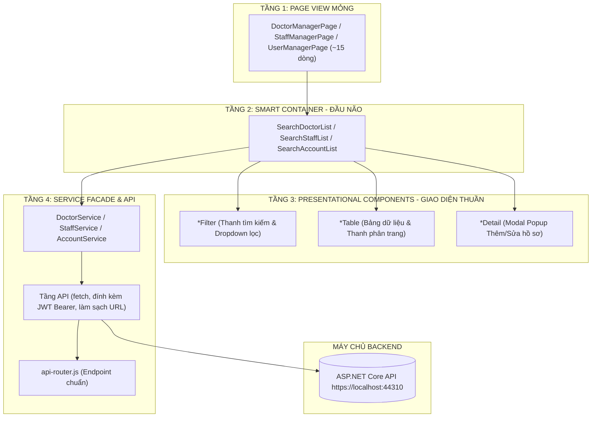

# TÀI LIỆU TOÀN DIỆN: KIẾN TRÚC VÀ CƠ CHẾ HOẠT ĐỘNG CỦA HỆ THỐNG VNUACARE

> **Phiên bản:** 4.0 (Kiến trúc Module hóa & Chuẩn hóa Layered Container)  
> **Áp dụng cho:** Phân hệ Quản trị (Admin: Bác sĩ, Cán bộ, Tài khoản) & Toàn bộ Hệ thống Frontend VnuaCare-UI

---

## MỤC LỤC
1. [Tổng quan Kiến trúc 4 tầng (Layered Architecture)](#1-tổng-quan-kiến-trúc-4-tầng)
2. [Cấu trúc Thư mục và Phân bổ Trách nhiệm](#2-cấu-trúc-thư-mục-và-phân-bổ-trách-nhiệm)
3. [Cơ chế "Data Down - Actions Up" (Dòng chảy dữ liệu & Sự kiện)](#3-cơ-chế-data-down---actions-up)
4. [Quy trình Hoạt động Chi tiết từng Luồng Nghiệp vụ](#4-quy-trình-hoạt-động-chi-tiết)
   - 4.1. Khởi tạo & Tải dữ liệu ban đầu
   - 4.2. Tìm kiếm, Lọc danh mục & Phân trang
   - 4.3. Thêm mới & Cập nhật hồ sơ qua Modal Form
   - 4.4. Xóa an toàn với Popup Confirm Delete
5. [Cơ chế Bảo vệ Gọi API & Xử lý Token JWT](#5-cơ-chế-bảo-vệ-gọi-api--xử-lý-token-jwt)
6. [Thư viện Tiện ích & Hằng số Chuẩn hóa (`src/utils/index.js`)](#6-thư-viện-tiện-ích--hằng-số-chuẩn-hóa)

---

## 1. TỔNG QUAN KIẾN TRÚC 4 TẦNG

Để giải quyết tình trạng các file giao diện quá lớn (600 - 800 dòng/file gây khó bảo trì, khó sửa giao diện), hệ thống được tái cấu trúc theo mô hình **Layered Component Architecture**:



### Ưu điểm vượt trội của mô hình 4 tầng:
1. **Trách nhiệm duy nhất (Single Responsibility):** File nào làm giao diện thì chỉ chứa JSX & CSS; file nào làm logic thì chỉ quản lý State & API.
2. **Kích thước file tinh gọn:** Từ 700+ dòng dồn cục giảm xuống chỉ còn **50 - 150 dòng/file**.
3. **An toàn khi nâng cấp:** Chỉnh sửa giao diện bảng hay đổi vị trí nút bấm trong `*Table.jsx` hoàn toàn không làm ảnh hưởng đến luồng gọi API hay logic State của Container.

---

## 2. CẤU TRÚC THƯ MỤC VÀ PHÂN BỔ TRÁCH NHIỆM

### 2.1. Cấu trúc thư mục tại `src/`

```
src/
├── app/
│   └── AppRouter.jsx                 # Điều hướng Route Guard & chuyển Tab không reload
├── components/
│   ├── Admin/                        # [TẦNG COMPONENT QUẢN TRỊ ADMIN]
│   │   ├── DoctorManagement/
│   │   │   ├── DoctorFilter.jsx      # Bộ lọc tìm kiếm & Chuyên khoa
│   │   │   ├── DoctorTable.jsx       # Bảng hiển thị bác sĩ & Phân trang
│   │   │   ├── DoctorDetail.jsx      # Modal popup Thêm/Sửa bác sĩ
│   │   │   └── SearchDoctorList.jsx  # Smart Container kết nối API DoctorService
│   │   ├── StaffManagement/
│   │   │   ├── StaffFilter.jsx       # Bộ lọc tìm kiếm & Phòng ban
│   │   │   ├── StaffTable.jsx        # Bảng hiển thị cán bộ & Phân trang
│   │   │   ├── StaffDetail.jsx       # Modal popup Thêm/Sửa cán bộ & Chọn Avatar
│   │   │   └── SearchStaffList.jsx   # Smart Container kết nối API StaffService
│   │   └── AccountManagement/
│   │       ├── AccountFilter.jsx     # Bộ lọc tìm kiếm & Vai trò (Role)
│   │       ├── AccountTable.jsx      # Bảng danh sách tài khoản & Phân trang
│   │       ├── AccountDetail.jsx     # Modal popup Thêm/Sửa/Khóa tài khoản
│   │       └── SearchAccountList.jsx # Smart Container kết nối API AccountService
│   ├── SupportAgent/
│   │   └── Icons.jsx                 # Bộ Icon SVG y tế chuẩn hóa (>400 dòng)
│   └── Icons.js                      # Cổng xuất Icon tập trung cho toàn app
├── services/
│   └── admin/                        # [TẦNG DỊCH VỤ FACADE ADMIN]
│       ├── DoctorService.js          # Service cung cấp API Bác sĩ
│       ├── StaffService.js           # Service cung cấp API Cán bộ
│       └── AccountService.js         # Service cung cấp API Tài khoản
├── pages/                            # [TẦNG VIEW MỎNG]
│   ├── doctor-manager/DoctorManagerPage.jsx  # (14 dòng)
│   ├── staff-manager/StaffManagerPage.jsx    # (14 dòng)
│   └── user-manager/UserManagerPage.jsx      # (14 dòng)
└── utils/
    ├── api-router.js                 # Danh mục Endpoint API Backend
    └── index.js                      # Thư viện tiện ích và hằng số y tế VnuaCare
```

---

## 3. CƠ CHẾ "DATA DOWN - ACTIONS UP"

Đây là nguyên lý cốt lõi giúp các component giao tiếp với nhau mà không bao giờ bị xung đột dữ liệu:

```
                  ┌─────────────────────────────────────────┐
                  │       SMART CONTAINER (Ví dụ:           │
                  │         SearchDoctorList.jsx)           │
                  │  - Nắm giữ State: doctors, search,     │
                  │    pageNumber, modalMode, formData      │
                  └────┬───────────────────────────────▲────┘
                       │                               │
         DỮ LIỆU ĐI XUỐNG                              SỰ KIỆN ĐI LÊN
         (Data Down via Props)                         (Actions Up via Callbacks)
                       │                               │
       ┌───────────────┼───────────────┐               │
       ▼               ▼               ▼               │
┌──────────────┐┌──────────────┐┌──────────────┐       │
│ DoctorFilter ││ DoctorTable  ││ DoctorDetail │       │
│  - search    ││  - doctors   ││  - formData  │       │
│  - specialty ││  - loading   ││  - modalMode │       │
│  - options   ││  - pagination││  - error     │       │
└──────┬───────┘└──────┬───────┘└──────┬───────┘       │
       │               │               │               │
       └───────────────┴───────────────┴───────────────┘
          Bắn sự kiện ngược lên Container:
          • onSearchChange(val)
          • onPageChange(page)
          • onOpenEdit(doc)
          • onSubmit(formData)
```

1. **Dữ liệu đi xuống (Data Down):** Smart Container là nguồn chân lý duy nhất (Single Source of Truth). Nó truyền mảng danh sách, trạng thái loading, số trang, dữ liệu form xuống cho `Filter`, `Table`, `Detail` thông qua `props`.
2. **Hành động đi lên (Actions Up):** Các component con tuyệt đối không tự sửa State của cha. Khi người dùng bấm nút, gõ chữ hay chọn trang, component con phát tín hiệu thông qua các hàm callback (`onSearchChange`, `onPageChange`, `onSubmit`) để Container xử lý.

---

## 4. QUY TRÌNH HOẠT ĐỘNG CHI TIẾT CỦA CÁC LUỒNG NGHIỆP VỤ

### 4.1. Khởi tạo & Tải dữ liệu ban đầu (Initial Load)
1. Khi người dùng click chọn tab trên Menu Sidebar, `AppRouter` render Page tương ứng.
2. Page View bọc `MainLayout` và mount `Search*List` Container.
3. Container kích hoạt `useEffect` khởi tạo:
   - Sử dụng `Promise.allSettled` gọi song song API danh mục (Khoa phòng/Chuyên khoa) và danh sách tài khoản User liên kết.
   - Gọi hàm lấy danh sách phân trang (trang 1, 10 bản ghi mặc định).
4. Container cập nhật `setLoading(false)` và truyền mảng dữ liệu vào `*Table` để hiển thị.

### 4.2. Tìm kiếm, Lọc danh mục & Phân trang
- **Tìm kiếm từ khóa:**
  - Người dùng gõ vào ô tìm kiếm $\rightarrow$ `*Filter` gọi `onSearchChange` $\rightarrow$ Container set lại state `search` và tự động reset `pageNumber = 1`.
  - `useEffect` lắng nghe `[search, selectedFilter, pageNumber, pageSize, refreshKey]` sẽ tự động gọi API lấy dữ liệu mới $\rightarrow$ Bảng tự động cập nhật mà không cần bấm Enter hay tải lại trang.
- **Phân trang (Pagination):**
  - Người dùng chọn số lượng bản ghi hiển thị (`5, 10, 20, 50 / trang`) $\rightarrow$ Gọi `onPageSizeChange(size)`.
  - Người dùng bấm nút `Trước`, `Sau` hoặc số trang cụ thể $\rightarrow$ Gọi `onPageChange(page)`.
  - Container cập nhật `pageNumber` $\rightarrow$ Fetch đúng trang dữ liệu đó từ máy chủ.

### 4.3. Thêm mới & Cập nhật hồ sơ qua Modal Form
- **Mở Modal:**
  - Bấm "Thêm mới" $\rightarrow$ Container đặt `modalMode = 'CREATE'` và gán `formData = INITIAL_FORM`.
  - Bấm icon "Sửa" trên 1 dòng của bảng $\rightarrow$ Container đặt `modalMode = 'EDIT'` và nạp dữ liệu của dòng đó vào `formData`.
- **Nhập liệu & Validate:**
  - Người dùng thay đổi các trường trong form $\rightarrow$ `*Detail` kích hoạt `onFormChange(field, value)` để cập nhật giá trị tức thời.
- **Lưu dữ liệu:**
  - Người dùng bấm "Lưu thay đổi" $\rightarrow$ `onSubmit` được gọi.
  - Container kiểm tra validate (Mã không rỗng, tài khoản liên kết đã chọn...).
  - Gọi Service tương ứng: `create*` hoặc `update*`.
  - Khi máy chủ trả về thành công:
    - Bắn Toast xanh báo thành công ở góc trên màn hình (tự ẩn sau 3 giây).
    - Đóng Modal (`modalMode = null`).
    - Tăng `refreshKey = refreshKey + 1` để kích hoạt `useEffect` tải lại bảng với dữ liệu mới nhất.

### 4.4. Xóa an toàn với Popup Confirm Delete
- Để tránh việc bấm nhầm xóa mất dữ liệu quan trọng, khi người dùng bấm icon Thùng rác $\rightarrow$ Một Modal xác nhận riêng biệt mở ra, hiển thị rõ Họ tên và Mã đối tượng cần xóa.
- Khi người dùng bấm nút đỏ "Xác nhận xóa":
  - Container bật trạng thái `deleteLoading = true`.
  - Gọi Service `.delete*(id)`.
  - Xóa thành công $\rightarrow$ Hiển thị Toast thông báo, đóng Modal xác nhận và tải lại bảng.

### 4.5. Phân hệ Chẩn đoán hình ảnh & Thăm dò chức năng (Bác sĩ tự do nhập liệu)
- **Tự do nhập liệu chuyên môn:** Loại bỏ hoàn toàn các bản mẫu văn bản cố định (`ModalityTemplateFactory` trước đây cung cấp các câu chẩn đoán cứng cho gan, thận, phổi...). Thay vào đó, toàn bộ phiếu chẩn đoán hình ảnh được để trống để **bác sĩ tự do điền thông tin thực tế thăm khám**.
- **Quy trình lập phiếu:**
  1. Bác sĩ bấm **"Thêm phiếu"** $\rightarrow$ Hệ thống lập tức khởi tạo phiếu trắng (`DiagnosticReport.createBlank`).
  2. Bác sĩ chọn loại kỹ thuật chẩn đoán (`ULTRASOUND`, `XRAY`, `ECG`, `ENDOSCOPY`, `CT`, `MRI`).
  3. Bác sĩ điền: Tên chỉ định, thời gian, mô tả kỹ thuật.
  4. Bác sĩ tự do thêm/xóa các vùng thăm khám (Gan, Tuyến giáp, Phổi, Tim...) và gõ các gạch đầu dòng mô tả chi tiết.
  5. Nhập kết luận chẩn đoán, chọn bác sĩ đọc / duyệt kết quả và bấm **"Lưu kết quả CĐHA"**.
- **Đóng gói Payload Backend:** Dữ liệu được đóng gói thành cấu trúc JSON chuẩn `{ technique, findings, conclusion }` lưu vào trường `findingsData` của SQL Database.

---

## 5. CƠ CHẾ BẢO VỆ GỌI API & XỬ LÝ TOKEN JWT

### 5.1. Khắc phục triệt để lỗi Double Slash (`//api`) gây mã lỗi 404
Trước đây, nếu trong `.env` có dấu gạch chéo cuối như `https://localhost:44310/` thì khi ghép với `/api/...` sẽ tạo thành:
$$\text{URL} = \text{https://localhost:44310//api/v1/authorization/login}$$
Lỗi này khiến router ASP.NET Core không nhận diện được và trả về **404 Not Found**.

**Cơ chế phòng vệ đã áp dụng:**
Toàn bộ các file API (`authApi`, `doctorApi`, `staffApi`, `userApi`, `recordApi`...) đều sử dụng hàm làm sạch URL:
```javascript
const API_BASE_URL = (import.meta.env.VITE_API_BASE_URL || '').replace(/\/+$/, '');
```
Hàm Regex `replace(/\/+$/, '')` sẽ tự động cắt bỏ mọi dấu `/` ở cuối biến môi trường, đảm bảo URL luôn luôn chuẩn xác dạng `https://localhost:44310/api/...`.

### 5.2. Tự động đính kèm Token xác thực JWT Bearer
Tất cả các API yêu cầu đăng nhập đều sử dụng hàm `getAuthHeaders()`:
```javascript
function getAuthHeaders() {
  const token = localStorage.getItem('accessToken');
  return {
    'Content-Type': 'application/json',
    Authorization: `Bearer ${token}`,
  };
}
```
Nếu phiên làm việc hết hạn (`response.status === 401`), hệ thống ném ra ngoại lệ yêu cầu đăng nhập lại để bảo vệ dữ liệu.

---

## 6. THƯ VIỆN TIỆN ÍCH & HẰNG SỐ CHUẨN HÓA (`src/utils/index.js`)

File tiện ích dùng chung được thiết kế bằng **JavaScript thuần (Vanilla JS)** hiện đại, không phụ thuộc thư viện cồng kềnh:

| Tên Hằng số / Hàm | Kiểu | Mô tả & Ví dụ sử dụng |
|---|---|---|
| `ROLES` | Object | Danh sách vai trò: `SUPER_ADMIN`, `HEALTH_ADMIN`, `DOCTOR`, `STAFF` |
| `RECORD_STATUS` | Object | Trạng thái hồ sơ KSK: `PENDING`, `IN_PROGRESS`, `COMPLETED`, `CANCELLED` |
| `HEALTH_CLASSIFICATIONS` | Array | 5 mức xếp loại sức khỏe chuẩn BYT: `['Loại I', 'Loại II', 'Loại III', 'Loại IV', 'Loại V']` |
| `GENDER` | Object | Giới tính: `{ MALE: 'Nam', FEMALE: 'Nữ' }` |
| `formatedDate(date)` | Function | Chuyển đổi ngày sang định dạng `DD/MM/YYYY`. Ví dụ: `2026-11-18` $\rightarrow$ `18/11/2026` |
| `formatedDateTime(date)` | Function | Chuyển đổi ngày giờ sang `DD/MM/YYYY HH:mm` |
| `getToday()` | Function | Trả về chuỗi ngày hôm nay theo giờ địa phương |
| `birthdayAndAge(date)` | Function | Tự động tính số tuổi: `"1990-05-15"` $\rightarrow$ `"15/05/1990 - 36 tuổi"` |
| `getIdxTable(idx, page, pageSize)` | Function | Tính số thứ tự dòng liên tục qua các trang phân trang: `(page - 1) * pageSize + idx + 1` |
| `formatPrice(price)` | Function | Định dạng tiền tệ VNĐ: `150000` $\rightarrow$ `150.000 ₫` |
| `beforeUpload(file)` | Function | Kiểm tra file ảnh hợp lệ: định dạng JPG/PNG/JPEG và dung lượng `< 2MB` |
| `getBase64(file, callback)` | Function | Đọc file ảnh sang chuỗi mã hóa Base64 phục vụ preview ảnh |

---

## 7. TỔNG KẾT
Kiến trúc phân tầng mới đã đưa toàn bộ hệ thống VnuaCare-UI về trạng thái **chuẩn hóa doanh nghiệp**:
- Tốc độ Build Vite siêu tốc (**~130ms**).
- Mã nguồn tường minh, dễ đọc, dễ kiểm thử và sẵn sàng cho việc mở rộng các phân hệ tiếp theo.
