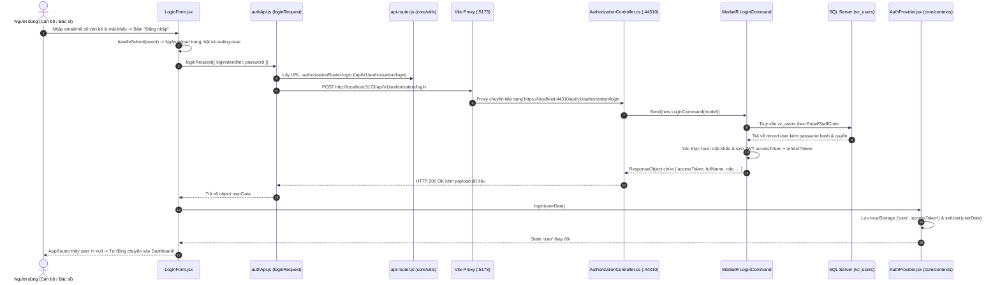
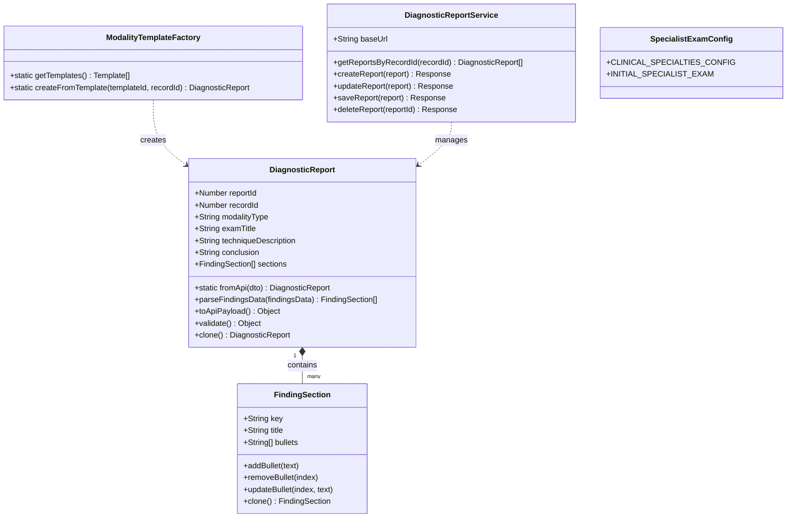

# TÀI LIỆU TOÀN DIỆN: LUỒNG HOẠT ĐỘNG TOÀN BỘ HỆ THỐNG VNUACARE-UI

> **Dự án:** Hệ thống Quản lý Khám Sức Khỏe Cán bộ & Nhân viên — Trạm Y tế VNUA  
> **Frontend:** React 19 + Vite 8 + CSS Isolated (mỗi Tab 1 file CSS riêng)  
> **Kiến trúc:** Feature-Driven Architecture + Domain-Driven Design (DDD)  
> **Backend:** ASP.NET Core 8 Web API + MediatR + Entity Framework Core  
> **Cơ sở dữ liệu:** Microsoft SQL Server — `VnuaCareDB`  
> **Phiên bản tài liệu:** 3.0 — Cập nhật cấu trúc chuẩn Feature-Driven (2026-11-17)

---

## MỤC LỤC

1. [Cấu Trúc Thư Mục Chuẩn `src/`](#1-cấu-trúc-thư-mục-chuẩn-src)
2. [Khởi Động Ứng Dụng (Bootstrap)](#2-khởi-động-ứng-dụng-bootstrap)
3. [Luồng Đăng Nhập & Xác Thực](#3-luồng-đăng-nhập--xác-thực)
4. [Vite Proxy — Giải Quyết CORS](#4-vite-proxy--giải-quyết-cors)
5. [Khung Giao Diện Chính & Điều Hướng](#5-khung-giao-diện-chính--điều-hướng)
6. [Phân Hệ Quản Lý Hồ Sơ Khám (HealthRecordsPage)](#6-phân-hệ-quản-lý-hồ-sơ-khám-healthrecordspage)
7. [5 Tab Phiếu Khám Chuyên Khoa](#7-5-tab-phiếu-khám-chuyên-khoa)
8. [Kiến Trúc OOP — Tab 4 DiagnosticReports & Tab 3 SpecialistExams](#8-kiến-trúc-oop--tab-4-diagnosticreports--tab-3-specialistexams)
9. [Định Dạng JSON findings_data (CĐHA)](#9-định-dạng-json-findings_data-cđha)
10. [Toàn Bộ API Router — Ánh Xạ Endpoint](#10-toàn-bộ-api-router--ánh-xạ-endpoint)
11. [Hằng Số Frontend — Classifications & Statuses](#11-hằng-số-frontend--classifications--statuses)
12. [Cấu Hình Chuyên Khoa Lẻ — SpecialistExam Model](#12-cấu-hình-chuyên-khoa-lẻ--specialistexam-model)
13. [Tổ Chức CSS — Isolated Co-location](#13-tổ-chức-css--isolated-co-location)
14. [Barrel Export Tabs — index.js](#14-barrel-export-tabs--indexjs)
15. [Bảng Tra Cứu Tổng Hợp (Cheat-Sheet)](#15-bảng-tra-cứu-tổng-hợp-cheat-sheet)

---

## 1. CẤU TRÚC THƯ MỤC CHUẨN `src/`

```
src/
├── main.jsx                          # Điểm vào Vite — mount <App /> vào <div id="root">
├── App.jsx                           # Bọc AuthProvider + NavigationProvider + AppRouter
├── index.css                         # CSS reset toàn cục
│
├── app/
│   └── AppRouter.jsx                 # Gác cổng an ninh + điều hướng trang theo activeTab
│
├── assets/
│   └── img_avatars/                  # SVG avatar bác sĩ / cán bộ
│
├── core/                             # === TẦNG CỐT LÕI DÙNG CHUNG (Core Platform) ===
│   ├── components/                   # UI Components dùng chung toàn app
│   │   ├── Icons.jsx                 # Thư viện Icon SVG
│   │   └── Tabs.jsx                  # Component Tabs dùng chung
│   ├── contexts/                     # Toàn bộ Context tập trung tại đây
│   │   ├── authContext.js            # AuthContext object
│   │   ├── AuthProvider.jsx          # Quản lý User, Token, Login, Logout
│   │   ├── useAuth.js                # Hook tiêu thụ AuthContext
│   │   ├── navigationContext.js      # NavigationContext object
│   │   ├── NavigationProvider.jsx    # Quản lý activeTab, navigate
│   │   └── useNavigation.js          # Hook tiêu thụ NavigationContext
│   ├── data/
│   │   ├── avatarData.js             # Dữ liệu ánh xạ avatar
│   │   └── menuNavData.js            # 6 mục menu Sidebar
│   ├── layouts/                      # Khung giao diện chính (Shell)
│   │   ├── MainLayout.jsx & .css
│   │   └── components/
│   │       ├── Header.jsx
│   │       ├── Sidebar.jsx
│   │       └── Footer.jsx
│   └── utils/
│       └── api-router.js             # Trung tâm URL API duy nhất
│
├── features/                         # === TẦNG NGHIỆP VỤ (Feature-Driven Modules) ===
│   │                                 # Mỗi feature tự chứa ĐỦ: API, Models, Services, Components, Tabs
│   ├── auth/
│   │   ├── api/authApi.js
│   │   └── components/ (LoginForm.jsx, LoginVisual.jsx)
│   │
│   ├── health-records/               # Phân hệ Hồ sơ KSK (chuẩn danh từ y tế)
│   │   ├── api/
│   │   │   ├── recordApi.js          # Hồ sơ KSK, lookup danh mục
│   │   │   ├── vitalSignsApi.js      # Tab 1: Sinh tồn
│   │   │   ├── internalMedicineApi.js# Tab 2: Nội khoa
│   │   │   └── specialistExamApi.js  # Tab 3: Chuyên khoa
│   │   ├── models/
│   │   │   ├── DiagnosticReport.js   # OOP Domain Model CĐHA (FindingSection, DiagnosticReport, ModalityTemplateFactory)
│   │   │   └── SpecialistExam.js     # OOP Model Chuyên khoa (CLINICAL_SPECIALTIES_CONFIG, INITIAL_SPECIALIST_EXAM)
│   │   ├── services/
│   │   │   └── DiagnosticReportService.js # OOP Singleton Service CĐHA
│   │   ├── components/
│   │   │   ├── RecordDetailModal.jsx # Modal 5 Tab điều phối trung tâm
│   │   │   └── RecordDetailModal.css
│   │   └── tabs/                     # ★ 5 TAB KHÁM NẰM TRỌN VẸN TẠI ĐÂY!
│   │       ├── index.js              # Barrel export
│   │       ├── vital-signs/          (VitalSignsTab.jsx + VitalSignsTab.css)
│   │       ├── internal-medicine/    (InternalMedicineTab.jsx + InternalMedicineTab.css)
│   │       ├── specialist-exams/     (SpecialistExamsTab.jsx + SpecialistExamsTab.css)
│   │       ├── diagnostic-reports/   (DiagnosticReportsTab.jsx + DiagnosticReportsTab.css)
│   │       └── general-conclusion/   (GeneralConclusionTab.jsx + GeneralConclusionTab.css)
│   │
│   ├── doctors/
│   │   └── api/doctorApi.js
│   ├── staffs/
│   │   └── api/staffApi.js
│   └── users/
│       └── api/userApi.js
│
├── pages/                            # === TẦNG VIEW MỎNG (Views kết nối Router) ===
│   ├── auth/
│   │   ├── LoginPage.jsx & .css
│   ├── dashboard/
│   │   ├── DashboardPage.jsx & .css
│   ├── health-records/
│   │   ├── HealthRecordsPage.jsx & .css
│   ├── doctor-manager/
│   │   ├── DoctorManagerPage.jsx & .css
│   ├── staff-manager/
│   │   ├── StaffManagerPage.jsx & .css
│   └── user-manager/
│       ├── UserManagerPage.jsx & .css
│
└── styles/                           # === CHỈ CHỨA CSS TOÀN CỤC ===
    └── admin.css                     # Biến màu sắc, button, badge dùng chung
```

---

## 2. KHỞI ĐỘNG ỨNG DỤNG (BOOTSTRAP)

Khi người dùng mở trình duyệt gõ `http://localhost:5173`:

```
index.html 
   └── src/main.jsx (Mount React Root)
         └── src/App.jsx (Cung cấp Context toàn cục)
               ├── AuthProvider (core/contexts/AuthProvider.jsx)
               └── NavigationProvider (core/contexts/NavigationProvider.jsx)
                     └── AppRouter.jsx (app/AppRouter.jsx — Bộ điều hướng & Gác cổng an ninh)
```

### Các file & hàm tham gia:
1. **[main.jsx](file:///c:/Users/Admin/Documents/GitHub/VnuaCare-UI/src/main.jsx):** Điểm nhập chính của Vite, render component `<App />`.
2. **[App.jsx](file:///c:/Users/Admin/Documents/GitHub/VnuaCare-UI/src/App.jsx):** Bọc 2 Provider cốt lõi:
   * `<AuthProvider>`: Quản lý phiên đăng nhập (`user`, `login`, `logout`).
   * `<NavigationProvider>`: Quản lý trạng thái màn hình (`activeTab`, `navigate`).
3. **[AppRouter.jsx](file:///c:/Users/Admin/Documents/GitHub/VnuaCare-UI/src/app/AppRouter.jsx):**
   * Đọc biến `user` từ `useAuth()`.
   * **Nếu `!user` (chưa đăng nhập):** Chặn lại và render ngay màn hình `<LoginPage />`.
   * **Nếu đã có `user`:** Kiểm tra `activeTab` để render trang tương ứng (`DashboardPage`, `HealthRecordsPage`, `DoctorManagerPage`...).

---

## 3. LUỒNG ĐĂNG NHẬP & XÁC THỰC



---

## 4. VITE PROXY — GIẢI QUYẾT CORS

**File cấu hình:** [`vite.config.js`](file:///c:/Users/Admin/Documents/GitHub/VnuaCare-UI/vite.config.js)

```js
export default defineConfig({
  plugins: [react()],
  server: {
    proxy: {
      '/api': {
        target: 'https://localhost:44310',
        changeOrigin: true,
        secure: false, // Bỏ qua kiểm tra chứng chỉ SSL tự ký của localhost
      },
    },
  },
})
```

---

## 5. KHUNG GIAO DIỆN CHÍNH & ĐIỀU HƯỚNG

Sau khi đăng nhập thành công, `AppRouter.jsx` mở trang chính:

```
MainLayout.jsx (src/core/layouts/MainLayout.jsx)
├── Header.jsx (Logo VNUA, Chuông thông báo, Avatar bác sĩ, Nút Logout)
├── app-body
│    ├── Sidebar.jsx (Menu dọc bên trái chứa 6 chức năng chính)
│    └── app-main (Khu vực hiển thị nội dung của chức năng đang chọn)
└── Footer.jsx (Thông tin bản quyền Trạm Y tế VNUA)
```

---

## 6. PHÂN HỆ QUẢN LÝ HỒ SƠ KHÁM (`HealthRecordsPage`)

**File View:** [`src/pages/health-records/HealthRecordsPage.jsx`](file:///c:/Users/Admin/Documents/GitHub/VnuaCare-UI/src/pages/health-records/HealthRecordsPage.jsx)  
**File Style:** [`src/pages/health-records/HealthRecordsPage.css`](file:///c:/Users/Admin/Documents/GitHub/VnuaCare-UI/src/pages/health-records/HealthRecordsPage.css)  
**Tầng Feature:** `src/features/health-records/`

### Các bước hoạt động:
1. **Khởi tạo dữ liệu (Lookups):**
   * `useEffect` chạy `loadInitialLookups()`, gọi song song:
     * `getCampaignsSelectApi()`: Danh sách đợt khám.
     * `getDepartmentsSelectApi()`: Danh sách Khoa/Ban.
     * `getClassificationsApi()`: Danh mục chuẩn Bộ Y tế (Loại I đến Loại V) chuẩn hóa tại Frontend.
     * `getStatusesApi()`: Danh mục trạng thái (`DRAFT`, `IN_PROGRESS`, `COMPLETED`, `CANCELLED`).
     * `getDoctorsSelectApi()`: Danh sách bác sĩ tham gia khám.
     * `getStaffsSelectApi()`: Danh sách cán bộ.
2. **Lọc và phân trang hồ sơ:**
   * Gọi `getHealthRecordFilterApi(filterPayload)` ➔ POST `/api/v1/healthcheckuprecords/filter` ➔ Backend trả về danh sách hồ sơ kèm phân trang.
3. **Mở Modal chi tiết:**
   * Click vào một cán bộ ➔ `setViewingRecord(record)` ➔ Mở component `<RecordDetailModal />`.

---

## 7. 5 TAB PHIẾU KHÁM CHUYÊN KHOA

**File điều phối:** [`src/features/health-records/components/RecordDetailModal.jsx`](file:///c:/Users/Admin/Documents/GitHub/VnuaCare-UI/src/features/health-records/components/RecordDetailModal.jsx)  
Toàn bộ 5 Tab được import gọn qua barrel export:
```js
import { VitalSignsTab, InternalMedicineTab, SpecialistExamsTab,
         DiagnosticReportsTab, GeneralConclusionTab } from '../tabs';
```

---

### 7.1. Tab 1: Thể Lực & Dấu Hiệu Sinh Tồn (`VitalSignsTab`)
* **Thư mục:** `src/features/health-records/tabs/vital-signs/`
* **File:** `VitalSignsTab.jsx` & `VitalSignsTab.css`
* **API:** `src/features/health-records/api/vitalSignsApi.js`
* **Endpoint:** `/api/v1/vitalsigns/{recordId}` | **Bảng CSDL:** `vc_vital_signs`
* **Nghiệp vụ tự động (Real-time):** Tính `BMI = weight / (height/100)²`, hàm `evaluateBmi()` đánh giá gầy/cân đối/thừa cân/béo phì, hàm `evaluateBloodPressure()` cảnh báo huyết áp.

---

### 7.2. Tab 2: Khám Nội Khoa Tổng Quát (`InternalMedicineTab`)
* **Thư mục:** `src/features/health-records/tabs/internal-medicine/`
* **File:** `InternalMedicineTab.jsx` & `InternalMedicineTab.css`
* **API:** `src/features/health-records/api/internalMedicineApi.js`
* **Endpoint:** `/api/v1/internalmedicines/{recordId}` | **Bảng CSDL:** `vc_internal_medicine_exams`
* **Nội dung:** Khám 6 hệ cơ quan (Tuần hoàn, Hô hấp, Tiêu hóa, Thận - Tiết niệu, Cơ - Xương - Khớp, Thần kinh), kết luận và xếp loại chuyên khoa (Loại I - V).

---

### 7.3. Tab 3: Khám Chuyên Khoa Lẻ (`SpecialistExamsTab`)
* **Thư mục:** `src/features/health-records/tabs/specialist-exams/`
* **File:** `SpecialistExamsTab.jsx` & `SpecialistExamsTab.css`
* **Model:** `src/features/health-records/models/SpecialistExam.js` (`CLINICAL_SPECIALTIES_CONFIG`, `INITIAL_SPECIALIST_EXAM`)
* **API:** `src/features/health-records/api/specialistExamApi.js`
* **Endpoint:** `/api/v1/specialistexams/{recordId}?specialtyType=...` | **Bảng CSDL:** `vc_specialist_exams`
* **Nội dung:** 6 chuyên khoa lâm sàng (`EYE`, `ENT`, `DENTAL`, `DERMATOLOGY`, `SURGERY`, `OBSTETRICS`). Khung bên phải đổi linh hoạt theo chuyên khoa (thị lực Snellen cho Mắt, công thức răng cho Răng Hàm Mặt, tai mũi họng, da liễu...).

---

### 7.4. Tab 4: CĐHA & Thăm Dò Chức Năng (`DiagnosticReportsTab`) - OOP
* **Thư mục:** `src/features/health-records/tabs/diagnostic-reports/`
* **File:** `DiagnosticReportsTab.jsx` & `DiagnosticReportsTab.css`
* **Model:** `src/features/health-records/models/DiagnosticReport.js`
* **Service:** `src/features/health-records/services/DiagnosticReportService.js`
* **Endpoint:** `/api/v1/diagnosticreports/{recordId}` | **Bảng CSDL:** `vc_diagnostic_reports`
* **Nội dung:** Xem và nhập kết quả Siêu âm, X-quang, Điện tim, Nội soi. Tự động parse JSON `findings_data` mảng gạch đầu dòng `[]` thành các `FindingSection`. Cung cấp 6 mẫu template điền nhanh từ `ModalityTemplateFactory`.

---

### 7.5. Tab 5: Kết Luận & Xếp Loại Tổng Thể (`GeneralConclusionTab`)
* **Thư mục:** `src/features/health-records/tabs/general-conclusion/`
* **File:** `GeneralConclusionTab.jsx` & `GeneralConclusionTab.css`
* **API:** `src/features/health-records/api/recordApi.js`
* **Endpoint:** `/api/v1/healthcheckuprecords/{recordId}` | **Bảng CSDL:** `vc_health_checkup_records`
* **Nội dung:** Bác sĩ Chủ trì hội đồng tổng hợp kết quả 4 tab trước, chọn Xếp loại sức khỏe tổng thể (Loại I - V), ghi hướng điều trị, chọn bác sĩ ký kết luận và chuyển trạng thái `COMPLETED`.

---

## 8. KIẾN TRÚC OOP — TAB 4 & TAB 3



---

## 9. ĐỊNH DẠNG JSON `findings_data` (CĐHA)

Cột `findings_data` trong bảng `vc_diagnostic_reports` lưu dạng JSON Array:

```json
{
  "technique": "Siêu âm ổ bụng tổng quát bằng đầu dò Convex 3.5MHz",
  "findings": {
    "liver": ["Kích thước bình thường", "Nhu mô đều, bờ nhẵn", "Không thấy khối khu trú"],
    "gallbladder": ["Kích thước bình thường", "Lòng túi mật sạch, không có sỏi"],
    "pancreas": ["Hình dạng và kích thước bình thường", "Nhu mô đồng nhất"],
    "spleen": ["Kích thước bình thường", "Nhu mô đồng nhất"],
    "right_kidney": ["Vị trí và kích thước bình thường", "Đài bể thận không giãn, không sỏi"],
    "left_kidney": ["Vị trí và kích thước bình thường", "Đài bể thận không giãn, không sỏi"]
  },
  "conclusion": "Hình ảnh siêu âm ổ bụng hiện tại chưa thấy bất thường."
}
```

---

## 10. TOÀN BỘ API ROUTER — ÁNH XẠ ENDPOINT

**File:** [`src/core/utils/api-router.js`](file:///c:/Users/Admin/Documents/GitHub/VnuaCare-UI/src/core/utils/api-router.js)

| Nhóm Router | Router Object | Ví dụ Endpoint |
|---|---|---|
| **Xác thực** | `authorizationRouter` | `POST /api/v1/authorization/login` |
| **Hồ sơ KSK** | `healthRecordRouter` | `POST /api/v1/healthcheckuprecords/filter` |
| **Sinh tồn** | `vitalSignsRouter` | `GET/POST/PUT /api/v1/vitalsigns/...` |
| **Nội khoa** | `internalMedicineRouter` | `GET/POST/PUT /api/v1/internalmedicines/...` |
| **Chuyên khoa** | `specialistExamRouter` | `GET/POST/PUT /api/v1/specialistexams/...` |
| **CĐHA** | `diagnosticReportRouter` | `GET/POST/PUT/DELETE /api/v1/diagnosticreports/...` |
| **Bác sĩ** | `doctorRouter` | `GET/POST/PUT /api/v1/doctors/...` |
| **Cán bộ** | `staffRouter` | `GET/POST/PUT /api/v1/staffs/...` |
| **Tài khoản** | `userManagerRouter` | `GET/POST/PUT /api/v1/users/...` |

---

## 11. HẰNG SỐ FRONTEND — CLASSIFICATIONS & STATUSES

**File:** [`src/features/health-records/api/recordApi.js`](file:///c:/Users/Admin/Documents/GitHub/VnuaCare-UI/src/features/health-records/api/recordApi.js)

* `DEFAULT_HEALTH_CLASSIFICATIONS`: Chuẩn Bộ Y tế (Loại I đến Loại V).
* `DEFAULT_RECORD_STATUSES`: `DRAFT` (Mới tiếp nhận), `IN_PROGRESS` (Đang khám), `COMPLETED` (Đã hoàn thành), `CANCELLED` (Đã hủy).

---

## 12. CẤU HÌNH CHUYÊN KHOA LẺ — `SpecialistExam` MODEL

**File:** [`src/features/health-records/models/SpecialistExam.js`](file:///c:/Users/Admin/Documents/GitHub/VnuaCare-UI/src/features/health-records/models/SpecialistExam.js)

```js
export const CLINICAL_SPECIALTIES_CONFIG = [
  { code: 'EYE', specialtyId: 8, defaultName: 'Chuyên khoa Mắt', desc: 'Đo thị lực mắt trái, mắt phải có kính và không kính' },
  { code: 'ENT', specialtyId: 4, defaultName: 'Tai - Mũi - Họng', desc: 'Khám tai màng nhĩ, hốc mũi, niêm mạc họng và thanh quản' },
  { code: 'DENTAL', specialtyId: 9, defaultName: 'Răng - Hàm - Mặt', desc: 'Khám tình trạng răng sâu, nha chu, hàm trên và hàm dưới' },
  { code: 'DERMATOLOGY', specialtyId: 10, defaultName: 'Chuyên khoa Da liễu', desc: 'Khám các bệnh ngoài da, dị ứng, nấm da' },
  { code: 'SURGERY', specialtyId: 11, defaultName: 'Ngoại khoa tổng quát', desc: 'Khám vận động cơ xương, cột sống, trĩ, thoát vị bẹn' },
  { code: 'OBSTETRICS', specialtyId: 7, defaultName: 'Sản - Phụ khoa (Nữ)', desc: 'Khám phụ khoa định kỳ dành riêng cho cán bộ nữ' },
];
```

---

## 13. TỔ CHỨC CSS — ISOLATED CO-LOCATION

Mỗi Component/Tab có file CSS **đi liền kề** (Co-location):
* `VitalSignsTab.jsx` ➔ `VitalSignsTab.css`
* `InternalMedicineTab.jsx` ➔ `InternalMedicineTab.css`
* `SpecialistExamsTab.jsx` ➔ `SpecialistExamsTab.css`
* `DiagnosticReportsTab.jsx` ➔ `DiagnosticReportsTab.css`
* `GeneralConclusionTab.jsx` ➔ `GeneralConclusionTab.css`
* `RecordDetailModal.jsx` ➔ `RecordDetailModal.css` (chỉ chứa shell modal)
* `styles/admin.css`: Chỉ chứa CSS toàn cục (`:root`, `.btn`, `.badge`).

---

## 14. BARREL EXPORT TABS — `index.js`

**File:** [`src/features/health-records/tabs/index.js`](file:///c:/Users/Admin/Documents/GitHub/VnuaCare-UI/src/features/health-records/tabs/index.js)

```js
export { default as VitalSignsTab } from './vital-signs/VitalSignsTab.jsx';
export { default as InternalMedicineTab } from './internal-medicine/InternalMedicineTab.jsx';
export { default as SpecialistExamsTab } from './specialist-exams/SpecialistExamsTab.jsx';
export { default as DiagnosticReportsTab } from './diagnostic-reports/DiagnosticReportsTab.jsx';
export { default as GeneralConclusionTab } from './general-conclusion/GeneralConclusionTab.jsx';
```

---

## 15. BẢNG TRA CỨU TỔNG HỢP (CHEAT-SHEET)

| Chức năng / Tab | File JSX (View) | File CSS | File API / Service | File Model / Config | API Endpoint | Bảng CSDL |
|---|---|---|---|---|---|---|
| **Đăng nhập** | `pages/auth/LoginPage.jsx` + `LoginForm.jsx` | `LoginPage.css` | `features/auth/api/authApi.js` | `core/contexts/AuthProvider.jsx` | `POST /api/v1/authorization/login` | `vc_users` |
| **Khung App** | `core/layouts/MainLayout.jsx` | `MainLayout.css` | — | `core/data/menuNavData.js` | — | — |
| **Dashboard** | `pages/dashboard/DashboardPage.jsx` | `DashboardPage.css` | — | — | — | — |
| **Quản lý Bác sĩ** | `pages/doctor-manager/DoctorManagerPage.jsx` | `DoctorManagerPage.css` | `features/doctors/api/doctorApi.js` | — | `/api/v1/doctors` | `vc_doctors` |
| **Quản lý Cán bộ** | `pages/staff-manager/StaffManagerPage.jsx` | `StaffManagerPage.css` | `features/staffs/api/staffApi.js` | `core/data/avatarData.js` | `/api/v1/staffs` | `vc_staffs` |
| **Quản lý User** | `pages/user-manager/UserManagerPage.jsx` | `UserManagerPage.css` | `features/users/api/userApi.js` | — | `/api/v1/users` | `vc_users` |
| **Danh sách Hồ sơ** | `pages/health-records/HealthRecordsPage.jsx` | `HealthRecordsPage.css` | `features/health-records/api/recordApi.js` | `DEFAULT_HEALTH_CLASSIFICATIONS` | `POST /api/v1/healthcheckuprecords/filter` | `vc_health_checkup_records` |
| **Modal Hồ sơ** | `features/health-records/components/RecordDetailModal.jsx` | `RecordDetailModal.css` | — | `features/health-records/tabs/index.js` | — | — |
| **Tab 1: Sinh tồn** | `features/health-records/tabs/vital-signs/VitalSignsTab.jsx` | `VitalSignsTab.css` | `features/health-records/api/vitalSignsApi.js` | `INITIAL_VITAL_SIGNS` | `/api/v1/vitalsigns/{recordId}` | `vc_vital_signs` |
| **Tab 2: Nội khoa** | `features/health-records/tabs/internal-medicine/InternalMedicineTab.jsx` | `InternalMedicineTab.css` | `features/health-records/api/internalMedicineApi.js` | `INITIAL_INTERNAL_EXAM` | `/api/v1/internalmedicines/{recordId}` | `vc_internal_medicine_exams` |
| **Tab 3: Chuyên khoa**| `features/health-records/tabs/specialist-exams/SpecialistExamsTab.jsx` | `SpecialistExamsTab.css` | `features/health-records/api/specialistExamApi.js` | `models/SpecialistExam.js` | `/api/v1/specialistexams/{recordId}` | `vc_specialist_exams` |
| **Tab 4: CĐHA** | `features/health-records/tabs/diagnostic-reports/DiagnosticReportsTab.jsx` | `DiagnosticReportsTab.css` | `features/health-records/services/DiagnosticReportService.js` | `models/DiagnosticReport.js` | `/api/v1/diagnosticreports/{recordId}` | `vc_diagnostic_reports` |
| **Tab 5: Kết luận** | `features/health-records/tabs/general-conclusion/GeneralConclusionTab.jsx`| `GeneralConclusionTab.css` | `features/health-records/api/recordApi.js` | `DEFAULT_RECORD_STATUSES` | `PUT /api/v1/healthcheckuprecords/update` | `vc_health_checkup_records` |

---

*Tài liệu được cập nhật lần cuối: 2026-11-17 bởi Antigravity Agent.*  
*Phiên bản 3.0 — Chuẩn hóa Feature-Driven Architecture hoàn tất.*
