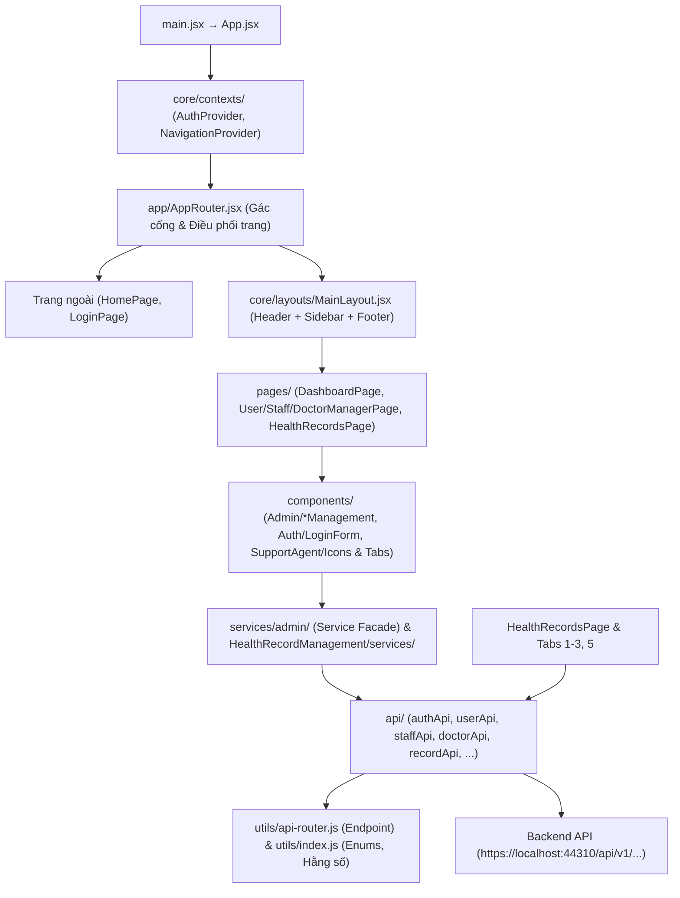
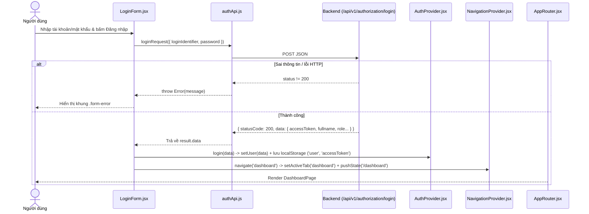

# Phân tích Cấu trúc, Quy ước Trình bày File và Cách Hoạt động của `src/` — VnuaCare-UI

> **Phạm vi tài liệu:** Phân tích trực tiếp dựa trên mã nguồn hiện tại trong thư mục `src/` của dự án **VnuaCare-UI** (Cổng quản lý & tra cứu hồ sơ khám sức khỏe định kỳ cán bộ Học viện Nông nghiệp Việt Nam — VNUA).

---

## Mục lục

1. [Tổng quan Công nghệ & Kiến trúc tổng thể `src/`](#1-tổng-quan-công-nghệ--kiến-trúc-tổng-thể-src)
2. [Cây thư mục thực tế của `src/` & Vai trò từng file](#2-cây-thư-mục-thực-tế-của-src--vai-trò-từng-file)
3. [Quy ước & Cách trình bày file trong `src/`](#3-quy-ước--cách-trình-bày-file-trong-src)
4. [Cách thức hoạt động của toàn bộ ứng dụng (Runtime Flows)](#4-cách-thức-hoạt-động-của-toàn-bộ-ứng-dụng-runtime-flows)
5. [Các điểm không đồng nhất & Lưu ý kỹ thuật hiện tại](#5-các-điểm-không-đồng-nhất--lưu-ý-kỹ-thuật-hiện-tại)

---

## 1. Tổng quan Công nghệ & Kiến trúc tổng thể `src/`

### 1.1. Công nghệ sử dụng (theo `package.json` & `vite.config.js`)

| Thành phần | Công nghệ / Phiên bản | Ghi chú |
|---|---|---|
| **UI Library** | React `^19.3.1` + React DOM `^19.3.1` | Single Page Application (SPA) |
| **Build Tool & Dev Server** | Vite `^8.3.5` + `@vitejs/plugin-react` | Proxy `/api` sang Backend `https://localhost:44310` |
| **Linter** | ESLint `^10.13.0` | Kết hợp `eslint-plugin-react-hooks`, `eslint-plugin-react-refresh` |
| **Styling** | CSS thuần (Pure CSS) | Không dùng Tailwind/Bootstrap; tách CSS hệ thống và CSS từng trang |
| **Routing** | Custom History API (`NavigationProvider` + `AppRouter`) | Không dùng `react-router-dom`, điều hướng bằng state + `window.history.pushState` |
| **Backend giao tiếp** | ASP.NET Core Web API qua `fetch` | Xác thực bằng JWT Bearer Token lưu tại `localStorage` |

### 1.2. Kiến trúc phân tầng của `src/`

Toàn bộ mã nguồn trong `src/` gồm **3 file gốc** (`main.jsx`, `App.jsx`, `index.css`) và **9 thư mục cấp 1** (`app/`, `core/`, `pages/`, `components/`, `services/`, `api/`, `utils/`, `styles/`, `assets/`):



> **Ghi chú về cấu trúc mới:** Các thư mục cũ như `src/features/` và `src/core/data/` đã được dọn bỏ khỏi mã nguồn; toàn bộ logic gọi API được gom về `src/api/`, giao diện chia về `src/pages/` và `src/components/`, dữ liệu dùng chung (`MENU_ITEMS`, `AVATAR_PRESETS`, `ROLES`, `ModelMode`...) được tập trung tại `src/utils/index.js`.

---

## 2. Cây thư mục thực tế của `src/` & Vai trò từng file

### 2.1. Cây thư mục đầy đủ

```text
src/
├── main.jsx                                  # Điểm khởi động React, mount <App /> vào #root
├── App.jsx                                   # Component gốc bọc AuthProvider + NavigationProvider + AppRouter
├── index.css                                 # CSS reset toàn cục, font Inter, thiết lập nền tảng
│
├── app/
│   └── AppRouter.jsx                         # Bộ định tuyến trung tâm & kiểm tra đăng nhập (Routing Guard)
│
├── core/
│   ├── contexts/
│   │   ├── authContext.js                    # Khởi tạo AuthContext
│   │   ├── AuthProvider.jsx                  # Giữ state user, login(), logout(), đồng bộ localStorage
│   │   ├── useAuth.js                        # Custom hook đọc AuthContext
│   │   ├── navigationContext.js              # Khởi tạo NavigationContext
│   │   ├── NavigationProvider.jsx            # Giữ state activeTab, navigate(), đồng bộ History API (/path)
│   │   └── useNavigation.js                  # Custom hook đọc NavigationContext (có kiểm tra Provider)
│   └── layouts/
│       ├── MainLayout.jsx                    # Khung bố cục quản trị: Header + Sidebar + main + Footer
│       ├── MainLayout.css                    # Style bố cục khung quản trị
│       └── components/
│           ├── Header.jsx                    # Thanh trên cùng: Logo, trạng thái API, thông báo, user, nút Đăng xuất
│           ├── Sidebar.jsx                   # Menu bên trái đọc MENU_ITEMS, render qua <Tabs />
│           └── Footer.jsx                    # Chân trang bản quyền VNUA & phiên bản hệ thống
│
├── pages/
│   ├── home/
│   │   ├── HomePage.jsx                      # Trang chủ công khai: tra cứu thông tin sức khỏe cán bộ VNUA
│   │   └── HomePage.css
│   ├── auth/
│   │   ├── LoginPage.jsx                     # Trang đăng nhập dạng thẻ bo góc trung tâm
│   │   └── LoginPage.css
│   ├── dashboard/
│   │   ├── DashboardPage.jsx                 # Trang tổng quan bảng điều khiển (hiện khởi tạo records rỗng [])
│   │   └── DashboardPage.css
│   ├── user-manager/
│   │   ├── UserManagerPage.jsx               # Trang mỏng bọc MainLayout + SearchAccountList
│   │   └── UserManagerPage.css
│   ├── staff-manager/
│   │   ├── StaffManagerPage.jsx              # Trang mỏng bọc MainLayout + SearchStaffList
│   │   └── StaffManagerPage.css
│   ├── doctor-manager/
│   │   ├── DoctorManagerPage.jsx             # Trang mỏng bọc MainLayout + SearchDoctorList
│   │   └── DoctorManagerPage.css
│   └── health-records/
│       ├── HealthRecordsPage.jsx             # Trang quản lý Hồ sơ khám sức khỏe (bộ lọc, bảng, form, modal)
│       └── HealthRecordsPage.css
│
├── components/
│   ├── Auth/
│   │   ├── LoginForm.jsx                     # Biểu mẫu đăng nhập (tài khoản, mật khẩu, ẩn/hiện pass, gọi loginRequest)
│   │   └── LoginVisual.jsx                   # Component giới thiệu đăng nhập cũ (hiện chưa được import sử dụng)
│   ├── SupportAgent/
│   │   ├── Icons.jsx                         # Tập hợp >20 icon SVG dùng chung (IconDashboard, IconPlus, IconClose...)
│   │   └── Tabs.jsx                          # Component vỏ bọc đa hình (polymorphic container) cho nhóm nút tab/menu
│   └── Admin/
│       ├── AccountManagement/
│       │   ├── SearchAccountList.jsx         # Container điều phối quản lý tài khoản
│       │   ├── AccountFilter.jsx             # Thanh tìm kiếm + lọc theo Role
│       │   ├── AccountTable.jsx              # Bảng danh sách tài khoản + phân trang
│       │   └── AccountDetail.jsx             # Modal thêm/sửa tài khoản
│       ├── DoctorManagement/
│       │   ├── SearchDoctorList.jsx          # Container điều phối quản lý bác sĩ
│       │   ├── DoctorFilter.jsx              # Thanh tìm kiếm + lọc chuyên khoa
│       │   ├── DoctorTable.jsx               # Bảng danh sách bác sĩ + phân trang
│       │   └── DoctorDetail.jsx              # Modal thêm/sửa thông tin bác sĩ
│       ├── StaffManagement/
│       │   ├── SearchStaffList.jsx           # Container điều phối quản lý cán bộ/nhân viên
│       │   ├── StaffFilter.jsx               # Thanh tìm kiếm + lọc Khoa/Phòng ban
│       │   ├── StaffTable.jsx                # Bảng danh sách cán bộ + phân trang
│       │   └── StaffDetail.jsx               # Modal thêm/sửa hồ sơ cán bộ + chọn avatar
│       └── HealthRecordManagement/
│           ├── RecordDetailModal.jsx         # Modal điều phối 5 tab khám chuyên môn cho 1 hồ sơ
│           ├── RecordDetailModal.css
│           ├── models/
│           │   ├── DiagnosticReport.js       # Domain model OOP: MODALITY_CONFIG, FindingSection, DiagnosticReport
│           │   └── SpecialistExam.js         # Cấu hình 6 chuyên khoa lẻ (CLINICAL_SPECIALTIES_CONFIG) & form mẫu
│           ├── services/
│           │   └── DiagnosticReportService.js # Class Service OOP cho Tab 4 (ánh xạ entity DiagnosticReport)
│           └── tabs/
│               ├── index.js                  # Barrel file export 5 tab chuyên môn
│               ├── vital-signs/              # Tab 1: Thể lực & Sinh tồn (BMI WHO châu Á, huyết áp)
│               ├── internal-medicine/        # Tab 2: Khám nội khoa 6 hệ cơ quan
│               ├── specialist-exams/         # Tab 3: Chuyên khoa lẻ (Mắt, TMH, RHM, Da liễu, Ngoại, Sản)
│               ├── diagnostic-reports/       # Tab 4: CĐHA & Thăm dò chức năng (bác sĩ tự nhập phân vùng)
│               └── general-conclusion/       # Tab 5: Kết luận & Xếp loại tổng thể
│
├── services/
│   └── admin/
│       ├── AccountService.js                 # Service Facade bọc userApi
│       ├── DoctorService.js                  # Service Facade bọc doctorApi + userApi.getUserSelectApi('DOCTOR')
│       └── StaffService.js                   # Service Facade bọc staffApi + userApi.getUserSelectApi('STAFF')
│
├── api/
│   ├── authApi.js                            # API đăng nhập (/api/v1/authorization/login)
│   ├── userApi.js                            # API CRUD người dùng & getUserSelectApi
│   ├── staffApi.js                           # API CRUD cán bộ & danh mục phòng ban
│   ├── doctorApi.js                          # API CRUD bác sĩ & danh mục chuyên khoa
│   ├── recordApi.js                          # API hồ sơ khám + các lookup (đợt khám, khoa, bác sĩ, cán bộ...)
│   ├── vitalSignsApi.js                      # API Tab 1: Sinh tồn
│   ├── internalMedicineApi.js                # API Tab 2: Khám nội khoa
│   └── specialistExamApi.js                  # API Tab 3: Chuyên khoa lẻ
│
├── utils/
│   ├── api-router.js                         # Từ điển tập trung toàn bộ đường dẫn endpoint Backend
│   └── index.js                              # Enums & hằng số (METHODS, ROLES, RECORD_STATUS, ModelMode, MENU_ITEMS...)
│
├── styles/
│   └── admin.css                             # CSS dùng chung cho toàn bộ màn hình quản trị (bảng, filter, modal, toast...)
│
└── assets/
    └── img_avatars/                          # 6 ảnh đại diện SVG tĩnh (bacsi-1/2, nam-1/2, nu-1/2)
```

### 2.2. Bảng tóm tắt vai trò từng nhóm thư mục

| Thư mục / Nhóm | Vai trò chính | Ai gọi tới nó? |
|---|---|---|
| `src/main.jsx`, `src/App.jsx` | Khởi tạo React Root, bọc các Provider toàn cục | Trình duyệt tải qua `index.html` |
| `src/app/` | Gác cổng xác thực (`!user`) và chọn component trang theo `activeTab` | `App.jsx` |
| `src/core/contexts/` | Lưu và chia sẻ state toàn cục (`user`, `activeTab`) qua React Context | Mọi trang & component cần đăng nhập / chuyển trang |
| `src/core/layouts/` | Giữ bộ khung giao diện quản trị cố định (Header, Sidebar, Footer) | Các trang trong khu vực quản trị |
| `src/pages/` | Đại diện cho từng màn hình tương ứng với mỗi route (`/home`, `/login`, `/staffs`...) | `AppRouter.jsx` |
| `src/components/` | Các thành phần giao diện chia theo nghiệp vụ (`Admin/`, `Auth/`, `SupportAgent/`) | `pages/` và `core/layouts/` |
| `src/services/admin/` | Tầng trung gian (Facade) nhóm các hàm API theo nghiệp vụ quản trị | `SearchAccountList`, `SearchDoctorList`, `SearchStaffList` |
| `src/api/` | Gọi `fetch` HTTP tới ASP.NET Core Backend, đính kèm Bearer token, xử lý JSON/lỗi | `services/admin/`, `LoginForm`, `HealthRecordsPage`, các Tab |
| `src/utils/` | Lưu đường dẫn endpoint API (`api-router.js`) và enum/hằng số toàn hệ thống (`index.js`) | `api/`, `services/`, `components/`, `Sidebar` |
| `src/styles/`, `src/index.css` | Quy định giao diện chuẩn từ toàn cục (`index.css`) tới vùng Admin (`admin.css`) | `main.jsx`, `MainLayout.jsx` |
| `src/assets/img_avatars/` | Tài nguyên ảnh avatar SVG mặc định cho bác sĩ và cán bộ | `AVATAR_PRESETS` trong `utils/index.js` |

---

## 3. Quy ước & Cách trình bày file trong `src/`

### 3.1. Quy ước đặt tên file và thư mục

| Loại file / thư mục | Quy tắc đặt tên | Ví dụ thực tế |
|---|---|---|
| **File React Component, Service Facade, Domain Model** | `PascalCase` (`.jsx` hoặc `.js`) | `AppRouter.jsx`, `AccountService.js`, `DiagnosticReport.js`, `MainLayout.jsx` |
| **Thư mục module trong `components/`** | `PascalCase` | `AccountManagement/`, `DoctorManagement/`, `HealthRecordManagement/`, `SupportAgent/` |
| **Thư mục route trong `pages/` và tab trong `tabs/`** | `kebab-case` | `user-manager/`, `health-records/`, `vital-signs/`, `diagnostic-reports/` |
| **File API, Context, Custom Hook, CSS trang** | `camelCase` cho JS/Hook; khớp tên Page cho CSS | `authApi.js`, `authContext.js`, `useNavigation.js`, `HomePage.css` |
| **File định tuyến endpoint** | `kebab-case` | `api-router.js` |
| **Hằng số & Enum trong `utils/index.js`** | `UPPER_SNAKE_CASE` (hằng/danh mục) hoặc `PascalCase` (enum/color map) | `ROLES`, `RECORD_STATUS`, `MENU_ITEMS`, `ModelMode`, `SystemColors` |

### 3.2. 7 mẫu trình bày mã nguồn đang áp dụng trong `src/`

#### 1) Comment Header 3 dòng đầu file (tiếng Việt)
Phần lớn các file chính (`App.jsx`, `AppRouter.jsx`, `MainLayout.jsx`, `Header.jsx`, `Sidebar.jsx`, các file trong `AccountManagement`, `DoctorManagement`, `StaffManagement`, `api/`, `services/`) đều mở đầu bằng 3 dòng comment mô tả ngắn gọn:
- **Dòng 1:** Tên/vai trò tổng quan của file.
- **Dòng 2:** Phạm vi dữ liệu hoặc các chức năng chính mà file xử lý.
- **Dòng 3:** Các thành phần kết nối hoặc đầu ra (component con, service, kết quả trả về).

#### 2) Mẫu Page mỏng (Thin Page Wrapper)
Áp dụng cho `UserManagerPage.jsx`, `StaffManagerPage.jsx`, `DoctorManagerPage.jsx` (~15 dòng/file). File Page chỉ làm 2 việc:
1. Bọc nội dung trong `<MainLayout activeTab="...">`.
2. Nhúng duy nhất component Container trung tâm (`<SearchAccountList />`, `<SearchStaffList />`, `<SearchDoctorList />`).

#### 3) Mẫu Container / Presentational 4 file (Account / Doctor / Staff)
Mỗi phân hệ quản trị danh mục trong `src/components/Admin/*Management/` được tách đều thành 4 file theo cặp trách nhiệm:
- **`Search*List.jsx` (Container):** Nắm toàn bộ state (`items`, `loading`, `error`, `search`, bộ lọc, `pageNumber`, `pageSize`, `totalCount`, `refreshKey`, `modalMode`, `formData`, `toast`); gọi `*Service` trong `useEffect` kèm cờ `isCancelled` để tránh cập nhật state nhầm khi request cũ về muộn.
- **`*Filter.jsx` (Presentational):** Nhận giá trị filter + callback qua props để render `.filter-toolbar` (ô tìm kiếm, `<select>` lọc, nút đặt lại).
- **`*Table.jsx` (Presentational):** Render bảng `.admin-table`, xử lý 3 trạng thái hiển thị (đang tải, lỗi, danh sách trống), nút Sửa/Xóa và thanh phân trang.
- **`*Detail.jsx` (Presentational):** Render modal Thêm/Sửa dựa trên `modalMode === ModelMode.CREATE` hoặc `ModelMode.EDIT`.

#### 4) Mẫu Context tách 3 file (`*Context.js` + `*Provider.jsx` + `use*.js`)
Cả `auth` và `navigation` trong `src/core/contexts/` đều tách thành 3 file nhỏ thay vì viết chung 1 file:
1. `*Context.js`: chỉ gọi `createContext(null)` — giúp Vite React Fast Refresh hoạt động ổn định khi sửa Provider (không lỗi lẫn export component và non-component).
2. `*Provider.jsx`: quản lý `useState`/`useEffect` và bọc `<Context.Provider value={...}>{children}</Context.Provider>`.
3. `use*.js`: Custom Hook gọi `useContext(...)`. Riêng `useNavigation.js` kiểm tra `if (!context) throw new Error(...)` để phát hiện sớm nếu component gọi hook nằm ngoài `NavigationProvider`.

#### 5) Mẫu Service Facade (`services/admin/`) + Functional API (`src/api/`)
- **Tầng Endpoint (`src/utils/api-router.js`):** Lưu toàn bộ URL theo nhóm đối tượng (`authorizationRouter`, `userManagerRouter`, `staffRouter`, `doctorRouter`, `campaignRouter`, `healthRecordRouter`, `vitalSignsRouter`, `internalMedicineRouter`, `specialistExamRouter`, `diagnosticReportRouter`). Endpoint có tham số được viết dạng arrow function, ví dụ `delete: (id) => \`/api/v1/doctors/${id}\``.
- **Tầng API (`src/api/*.js`):** Mỗi file đọc `API_BASE_URL` từ `import.meta.env.VITE_API_BASE_URL || ''` và cắt dấu `/` cuối bằng `.replace(/\/+$/, '')`, định nghĩa `getAuthHeaders()` lấy `accessToken` từ `localStorage`, xử lý lỗi HTTP/`401` và xuất các hàm `async` thuần (`export async function ...`).
- **Tầng Service Facade (`src/services/admin/*Service.js`):** Gom các hàm API liên quan thành 1 object thống nhất (`AccountService`, `DoctorService`, `StaffService`) để UI không phụ thuộc trực tiếp vào nhiều file API rời rạc.

#### 6) Mẫu OOP Domain Model + Class Service + Barrel Export (`HealthRecordManagement/`)
Khác với 3 phân hệ danh mục dùng object Facade và state thuần, phân hệ chi tiết hồ sơ khám kết hợp lập trình hướng đối tượng cho nghiệp vụ phức tạp:
- **`models/DiagnosticReport.js`:** Định nghĩa `MODALITY_CONFIG`, class `FindingSection` (phân vùng giải phẫu + danh sách gạch đầu dòng) và class `DiagnosticReport` (`createBlank()`, `addSection()`, tự chuẩn hóa tiếng Việt thành key ASCII). Hiện sử dụng phiếu trắng để bác sĩ tự điền tự do, không gò theo mẫu có sẵn.
- **`models/SpecialistExam.js`:** Định nghĩa bảng ánh xạ 6 chuyên khoa (`CLINICAL_SPECIALTIES_CONFIG` nối mã chuyên khoa với `specialtyId`) và `INITIAL_SPECIALIST_EXAM`.
- **`services/DiagnosticReportService.js`:** Viết theo `class DiagnosticReportService`, chuyển đổi JSON trả về từ backend sang các thể hiện `DiagnosticReport` (cần thiết cho nghiệp vụ thêm/xóa phân vùng trên UI).
- **`tabs/index.js`:** File barrel re-export cả 5 tab (`VitalSignsTab`, `InternalMedicineTab`, `SpecialistExamsTab`, `DiagnosticReportsTab`, `GeneralConclusionTab`) giúp `RecordDetailModal.jsx` import gọn trong 1 câu lệnh.

#### 7) Phân tầng CSS theo phạm vi ảnh hưởng
CSS được nạp theo thứ tự từ rộng đến hẹp:
1. `src/index.css` (nạp tại `main.jsx`): reset `box-sizing`, margin, font `Inter`, `min-height: 100vh`.
2. `src/core/layouts/MainLayout.css` & `src/styles/admin.css` (nạp tại `MainLayout.jsx`): khung sườn `.app-layout`, `.top-header`, `.left-sidebar`, cùng toàn bộ class dùng chung cho các trang quản trị (`.admin-page-container`, `.panel-card`, `.filter-toolbar`, `.admin-table`, `.modal-backdrop`, `.admin-toast`...).
3. CSS riêng từng màn hình / tab (`HomePage.css`, `LoginPage.css`, `RecordDetailModal.css`, `VitalSignsTab.css`...): chỉ chứa style đặc thù của màn hình/tab đó.

---

## 4. Cách thức hoạt động của toàn bộ ứng dụng (Runtime Flows)

### 4.1. Luồng 1: Khởi động ứng dụng (Bootstrap)

1. Trình duyệt tải `index.html` có thẻ `<div id="root">`.
2. `src/main.jsx` gắn cây React bên trong `<StrictMode>` vào `#root` và nạp `src/index.css`.
3. `src/App.jsx` dựng 2 lớp Context toàn cục bọc quanh `AppRouter`:
   - **Lớp ngoài — `<AuthProvider>`:** Đọc `localStorage.getItem('user')`, parse JSON để khôi phục `user` nếu phiên đăng nhập trước còn lưu.
   - **Lớp trong — `<NavigationProvider>`:** Đọc `window.location.pathname` (bỏ dấu `/`); nếu URL là đường dẫn gốc `/`, kiểm tra `localStorage.getItem('accessToken')` để gán `activeTab` mặc định là `'dashboard'` (đã có token) hoặc `'home'` (chưa có token).
4. `<AppRouter />` đọc `{ user }` từ `useAuth()` và `{ activeTab }` từ `useNavigation()` để quyết định màn hình đầu tiên hiển thị.

### 4.2. Luồng 2: Xác thực, Duy trì phiên & Đăng xuất



- **Khi bấm Đăng xuất (`Header.jsx`):** Nút đăng xuất chạy đồng thời `logout()` (đặt `user = null`, xóa `'user'` và `'accessToken'` khỏi `localStorage`) và `navigate('home')` → `AppRouter` đưa người dùng về `HomePage` tại `/home`.
- **Cơ chế gác cổng ở `AppRouter.jsx`:**
  - Nếu `!user`: dù `activeTab` là bất kỳ trang quản trị nào (`/dashboard`, `/staffs`, `/records`...), `AppRouter` **chặn không cho vào** và chỉ cho phép hiển thị `<LoginPage />` (khi `activeTab === 'login'`) hoặc `<HomePage />` (mặc định).
  - Nếu `user` đã tồn tại: đi vào `switch (activeTab)` để mở trang tương ứng (`home`, `doctors`, `users`, `records`, `staffs`, `campaigns` → `PlaceholderPage`, còn lại / `dashboard` → `DashboardPage`).

### 4.3. Luồng 3: Điều hướng SPA không reload trang (không dùng `#`)

Dự án không dùng hash (`#`) mà sử dụng **History API thuần**:

1. Khi người dùng click mục menu trong `Sidebar.jsx` (hoặc nút trên `HomePage.jsx`, `LoginPage.jsx`, logo ở `Header.jsx`), component gọi `navigate(tabId)` lấy từ `useNavigation()`.
2. Trong `NavigationProvider.jsx`, `navigate(tabId)` thực hiện 2 bước:
   - `setActiveTab(tabId)` → kích hoạt React re-render `AppRouter` (và `Sidebar` để cập nhật class `'active'`).
   - `window.history.pushState(null, '', \`/${tabId}\`)` → đổi URL trên thanh địa chỉ thành `/staffs`, `/records`, `/home`... mà **không tải lại trang**.
3. Khi người dùng bấm nút **Back / Forward** của trình duyệt, listener `popstate` trong `NavigationProvider` đọc lại `window.location.pathname` để đồng bộ `activeTab` về đúng trang tương ứng.

### 4.4. Luồng 4: Luồng dữ liệu 4 tầng tại các trang Quản trị CRUD

Áp dụng cho **Quản lý người dùng (`/users`)**, **Quản lý nhân viên (`/staffs`)** và **Quản lý bác sĩ (`/doctors`)**:

```text
[1. Page mỏng]           UserManagerPage / StaffManagerPage / DoctorManagerPage
       │                 (Bọc MainLayout + render Container)
       ▼
[2. Container]           SearchAccountList / SearchStaffList / SearchDoctorList
       │                 - useEffect theo dõi [search, filter, pageNumber, pageSize, refreshKey]
       │                 - Dùng cờ isCancelled chống ghi đè state khi gõ tìm kiếm liên tục
       ▼
[3. Service Facade]      AccountService / StaffService / DoctorService
       │
       ▼
[4. Tầng API + Router]   userApi / staffApi / doctorApi  +  api-router.js
       │                 - Gửi fetch('/api/v1/...') kèm Header Authorization: Bearer <token>
       │                 - Vite proxy chuyển tiếp /api -> https://localhost:44310 (dev)
       ▼
   Trả kết quả { items, totalCount } -> Container cập nhật state -> *Table / *Filter / *Detail hiển thị
```

**Chu kỳ Thêm / Sửa / Xóa:** Khi submit ở modal `*Detail.jsx` hoặc xác nhận xóa thành công, Container đóng modal, bật toast thông báo 3 giây và tăng biến `refreshKey` (`setRefreshKey(prev => prev + 1)`). `refreshKey` nằm trong dependency array của `useEffect`, khiến danh sách tự động tải lại dữ liệu mới nhất từ server.

### 4.5. Luồng 5: Quy trình khám bệnh 5 Tab trong Hồ sơ sức khỏe (`HealthRecordsPage` & `RecordDetailModal`)

1. **`HealthRecordsPage.jsx`** khi mở lên sẽ gọi các hàm trong `src/api/recordApi.js` để nạp đồng thời:
   - Danh mục phục vụ lọc & tạo mới: đợt khám (`getCampaignsSelectApi`), khoa/phòng ban (`getDepartmentsSelectApi`), danh sách cán bộ (`getStaffsSelectApi`), danh sách bác sĩ (`getDoctorsSelectApi`), xếp loại & trạng thái (`getClassificationsApi`, `getStatusesApi`).
   - Danh sách hồ sơ khám theo từ khóa (tên/mã CB/mã SID), bộ lọc và phân trang (`getHealthRecordFilterApi`).
2. Khi người dùng bấm xem chi tiết 1 hồ sơ trên bảng, `viewingRecord` được gán dữ liệu và **`RecordDetailModal.jsx`** mở ra.
3. Trong `RecordDetailModal`, state cục bộ `activeTab` chuyển đổi độc lập 5 tab chuyên môn theo quy trình khám:

| Tab | Component | Nguồn dữ liệu / Model | Chức năng chính |
|---|---|---|---|
| **1. Thể Lực & Sinh Tồn** | `VitalSignsTab.jsx` | `vitalSignsApi.js` | Nhập chiều cao, cân nặng, vòng bụng, mạch, huyết áp, SpO₂, nhịp thở; tự động tính BMI theo chuẩn WHO châu Á & phân loại huyết áp trực tiếp |
| **2. Khám Nội Khoa** | `InternalMedicineTab.jsx` | `internalMedicineApi.js` | Nhập đánh giá 6 hệ cơ quan (tuần hoàn, hô hấp, tiêu hóa, tiết niệu, cơ xương khớp, thần kinh), kết luận & xếp loại nội khoa |
| **3. Chuyên Khoa Lẻ** | `SpecialistExamsTab.jsx` | `specialistExamApi.js` + `SpecialistExam.js` | Giao diện 2 cột chọn 6 chuyên khoa (Mắt, TMH, RHM, Da liễu, Ngoại, Sản) và nhập thông số chuyên biệt từng khoa |
| **4. CĐHA & Thăm Dò Chức Năng** | `DiagnosticReportsTab.jsx` | `DiagnosticReportService.js` + `DiagnosticReport.js` | Tạo phiếu mới trống (Siêu âm, X-Quang, Điện tim, Nội soi, CT, MRI), bác sĩ tự thêm phân vùng giải phẫu, gạch đầu dòng mô tả & kết luận |
| **5. Kết Luận & Xếp Loại Tổng Thể** | `GeneralConclusionTab.jsx` | `recordApi.js` | Ghi nhận tiền sử bệnh, chọn xếp loại (Loại I–V), lời khuyên, bác sĩ kết luận; khi lưu thành công gọi `onRecordUpdated` → `onRefreshList` để bảng bên ngoài tự tải lại |

---

## 5. Các điểm không đồng nhất & Lưu ý kỹ thuật hiện tại

Những điểm sau được ghi nhận trực tiếp từ mã nguồn hiện tại để tiện kiểm soát khi bảo trì hoặc nâng cấp tiếp:

1. **Màn hình chưa nối API đầy đủ:**
   - `DashboardPage.jsx` đang khởi tạo `const [records, setRecords] = useState([])` tĩnh ở client (chưa gọi API nạp số liệu thật dù giao diện hiển thị dòng `/api/v1/healthcheckuprecords`).
   - Tab `campaigns` trong `AppRouter.jsx` hiện đang render `<PlaceholderPage />` giữ chỗ (chưa có trang quản lý Đợt khám sức khỏe thực tế).
2. **Độ đồng nhất giữa các phân hệ Admin:**
   - 3 phân hệ *Tài khoản*, *Bác sĩ*, *Nhân viên* đã chuẩn hóa theo mô hình **Page mỏng → Container/Presentational 4 file → Service Facade → API**.
   - Riêng `HealthRecordsPage.jsx` (~892 dòng) vẫn viết gộp danh sách, bộ lọc, bảng, form tạo/sửa, xóa trong một file và import trực tiếp từ `src/api/recordApi.js` (chưa tách 4 file và chưa đi qua tầng `services/`).
3. **File cũ còn sót lại:**
   - `src/components/Auth/LoginVisual.jsx` không còn được import ở bất kỳ file nào sau khi `LoginPage.jsx` chuyển sang bố cục thẻ đơn ở giữa màn hình.
4. **Điểm cần lưu ý trong `userApi.js` & `utils/index.js`:**
   - Trong `src/api/userApi.js` (dòng 132), hàm `getUserSelectApi(role)` gọi `userManagerRouter.getSelect(role)` như một hàm, trong khi `src/utils/api-router.js` (dòng 15) đang khai báo `getSelect: '/api/v1/users/select'` là một chuỗi. Nếu gọi `getUserSelectApi` (được dùng bởi `DoctorService.getUserSelect` và `StaffService.getUserSelect` khi mở modal thêm mới bác sĩ/nhân viên), sẽ phát sinh lỗi `TypeError: userManagerRouter.getSelect is not a function` ở runtime.
   - Trong `src/utils/index.js` (dòng 10), `METHODS.DELETE` đang có dấu cách thừa `'DELETE '` (hiện các file API đã dùng trực tiếp chuỗi `'DELETE'` nên không bị lỗi, nhưng nên sửa nếu dùng lại `METHODS`).
5. **Triển khai Production với History API:**
   - `NavigationProvider.jsx` sử dụng URL sạch (`/dashboard`, `/staffs`, `/records`...) qua `window.history.pushState`. Khi chạy dev bằng Vite, mọi route hoạt động bình thường; nhưng khi deploy lên server tĩnh (Nginx, IIS, Netlify, Vercel...), bắt buộc phải cấu hình **SPA fallback** chuyển hướng mọi đường dẫn chưa khớp file tĩnh về `index.html` để tránh lỗi 404 khi nhấn F5.
   - Đồng thời, `AuthProvider.jsx` hiện chỉ khôi phục `user` từ `localStorage` mà chưa gọi endpoint `authorizationRouter.checkToken` để xác thực lại token còn hạn phía backend lúc tải lại trang.
